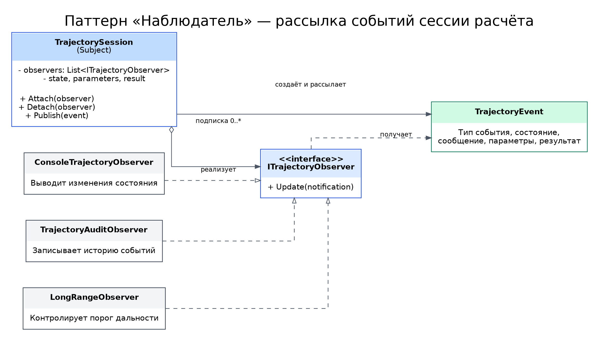
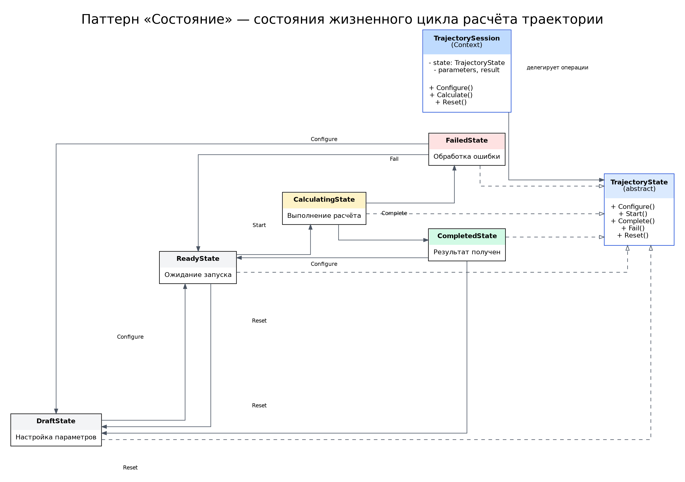
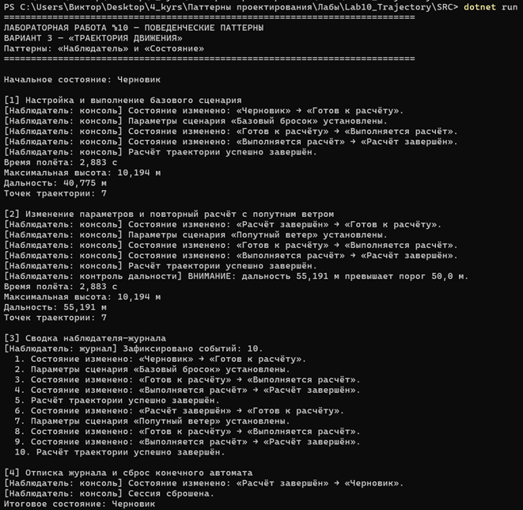

# Лабораторная работа №10

**Дисциплина:** Паттерны проектирования  
**Тема:** Поведенческие паттерны: «Наблюдатель», «Состояние»  
**Выполнил:** Блинов Виктор Александрович, 4 курс, группа ПИЖ-б-о-23-2  
**Направление подготовки:** 09.03.04 «Программная инженерия», очная форма обучения  
**Проверил:** Белик А. И., ассистент департамента цифровых, робототехнических систем и электроники  
**Учебное заведение:** Северо-Кавказский федеральный университет, Институт перспективной инженерии  
**Место и год:** Ставрополь, 2026 г.

**Оценка за защиту:** ____________  
**Дата защиты:** ____________  
**Подписи:** студент ____________ · преподаватель ____________

---

**Цель работы:** изучить назначение поведенческих паттернов «Наблюдатель» и «Состояние» и применить их при разработке прикладного программного решения.

**Задание:** реализовать приложение из предметной области согласно варианту 3 — «Траектория движения», используя паттерны из перечня лабораторной работы №10: «Наблюдатель» и «Состояние».

Приложение рассчитывает движение тела, брошенного под углом к горизонту. Для управления процессом используется конечный набор состояний сессии, отражающих этапы подготовки и выполнения расчёта. Изменения состояния и появление результата передаются подписанным компонентам: консольному наблюдателю, журналу событий и наблюдателю, контролирующему превышение заданной дальности.

## 1. Архитектура решения

Программа разделена на модели, расчётный механизм, подсистему уведомлений и набор состояний. `TrajectoryParameters` хранит исходные параметры, `TrajectoryPoint` описывает координаты тела в заданный момент времени, а `TrajectoryResult` содержит время полёта, максимальную высоту, дальность и рассчитанные точки.

`TrajectorySession` совмещает две роли. В паттерне «Состояние» он является Context и делегирует операции текущему объекту `TrajectoryState`. В паттерне «Наблюдатель» он является Subject: хранит список подписчиков, предоставляет методы подписки и отписки и рассылает уведомления при изменении состояния, параметров, результата или при сбросе сессии.

Состояния `DraftState`, `ReadyState`, `CalculatingState`, `CompletedState` и `FailedState` определяют допустимые операции на каждом этапе. Наблюдатели реализуют интерфейс `ITrajectoryObserver`. `ConsoleTrajectoryObserver` выводит сообщения, `TrajectoryAuditObserver` записывает историю событий, а `LongRangeObserver` предупреждает, если дальность превышает установленный порог.

Структура проекта:

- `SRC/Models` — параметры движения, точка траектории и результат;
- `SRC/Calculation` — вычисление физических характеристик;
- `SRC/Observer` — уведомления, интерфейс и конкретные наблюдатели;
- `SRC/State` — контекст и конкретные состояния жизненного цикла;
- `SRC/Validation` — проверка входных данных;
- `UML` — DOT-файлы и изображения диаграмм;
- `SRC/Program.cs` — сценарий настройки, расчёта и получения уведомлений.

## 2. Используемые технологии

- C# 12 и .NET 8;
- консольное приложение без сторонних библиотек;
- интерфейсы и отдельные классы состояний и наблюдателей;
- события представлены типизированной моделью `TrajectoryEvent`;
- UML-диаграммы классов и переходов состояний.

## 3. Паттерн «Наблюдатель»

Паттерн «Наблюдатель» задаёт зависимость типа «один ко многим»: при изменении объекта-субъекта все подписанные наблюдатели автоматически получают уведомление. Это позволяет добавлять новые способы реагирования на события без изменения расчётного механизма и без жёсткой привязки сессии к конкретным получателям сообщений.

В приложении субъектом является `TrajectorySession`. Методы `Attach()` и `Detach()` добавляют и удаляют наблюдателей. После изменения состояния или завершения расчёта метод `Publish()` формирует объект `TrajectoryEvent` и передаёт его каждому подписчику. Для безопасного перебора используется копия списка наблюдателей.

| Роль | Класс / интерфейс | Ответственность |
|---|---|---|
| Subject | `TrajectorySession` | Хранит подписчиков и рассылает уведомления об изменениях сессии. |
| Observer | `ITrajectoryObserver` | Задаёт общий метод `Update(notification)`. |
| Concrete Observer | `ConsoleTrajectoryObserver` | Показывает сообщения о переходах состояний и событиях. |
| Concrete Observer | `TrajectoryAuditObserver` | Сохраняет историю уведомлений и выводит её сводку. |
| Concrete Observer | `LongRangeObserver` | Проверяет дальность результата и выводит предупреждение при превышении порога. |
| Event | `TrajectoryEvent` | Передаёт тип события, имя состояния, сообщение, параметры и результат. |

Таблица 1 – Участники паттерна «Наблюдатель»



*Рисунок 1 – Диаграмма классов паттерна «Наблюдатель»*

На диаграмме показано, что `TrajectorySession` зависит от общего интерфейса `ITrajectoryObserver`, а не от конкретных наблюдателей. Поэтому можно добавить новый класс подписчика, например запись событий в файл или визуализацию графика, не изменяя логику расчёта.

Контракт наблюдателя:

```csharp
public interface ITrajectoryObserver
{
    void Update(TrajectoryEvent notification);
}
```

*Листинг 1 – Интерфейс наблюдателя*

Подписка и рассылка событий выполняются субъектом:

```csharp
public void Attach(ITrajectoryObserver observer)
{
    ArgumentNullException.ThrowIfNull(observer);
    if (!_observers.Contains(observer))
        _observers.Add(observer);
}

public void Detach(ITrajectoryObserver observer) =>
    _observers.Remove(observer);

private void Publish(TrajectoryEventType type, string message)
{
    var notification = new TrajectoryEvent(
        type, StateName, message, OccurredAt: DateTime.Now);
    foreach (ITrajectoryObserver observer in _observers.ToArray())
        observer.Update(notification);
}
```

*Листинг 2 – Подписка, отписка и отправка уведомлений*

## 4. Паттерн «Состояние»

Паттерн «Состояние» позволяет объекту изменять поведение в зависимости от внутреннего состояния. Вместо большого набора условных операторов в классе сессии каждая стадия работы представлена отдельным классом, реализующим общий интерфейс `TrajectoryState`.

`TrajectorySession` является контекстом и хранит ссылку на текущее состояние. Вызовы `Configure()`, `Calculate()` и `Reset()` делегируются соответствующему объекту состояния. Каждое состояние разрешает только подходящие ему операции. Например, параметры нельзя изменять во время расчёта, а запуск невозможен до настройки сценария.

| Роль | Класс | Ответственность |
|---|---|---|
| Context | `TrajectorySession` | Хранит текущее состояние и делегирует ему операции. |
| State | `TrajectoryState` | Определяет общий набор операций жизненного цикла. |
| Concrete State | `DraftState` | Начальная стадия; принимает параметры и переводит сессию в готовность. |
| Concrete State | `ReadyState` | Разрешает запуск расчёта и корректировку параметров. |
| Concrete State | `CalculatingState` | Представляет активное вычисление; принимает успешное завершение или ошибку. |
| Concrete State | `CompletedState` | Хранит состояние успешного завершения; допускает повторный запуск, настройку или сброс. |
| Concrete State | `FailedState` | Обрабатывает неудачный расчёт и допускает исправление параметров или повтор. |

Таблица 2 – Участники паттерна «Состояние»



*Рисунок 2 – Диаграмма классов и переходов паттерна «Состояние»*

Основной путь работы сессии: `DraftState` → `ReadyState` → `CalculatingState` → `CompletedState`. Если во время вычисления возникает исключение, `CalculatingState` переводит объект в `FailedState`. После ошибки параметры можно исправить, вернувшись в `ReadyState`. Сброс из доступных конечных состояний возвращает сессию в `DraftState`.

Общий интерфейс состояний содержит операции настройки, запуска, завершения, фиксации ошибки и сброса:

```csharp
public abstract class TrajectoryState
{
    public abstract string Name { get; }
    public virtual void Configure(
        TrajectorySession session, TrajectoryParameters parameters) =>
        Reject("изменение параметров");
    public virtual void Start(TrajectorySession session) =>
        Reject("запуск расчёта");
    public virtual void Complete(
        TrajectorySession session, TrajectoryResult result) =>
        Reject("завершение расчёта");
    public virtual void Fail(TrajectorySession session, string error) =>
        Reject("фиксация ошибки");
}
```

*Листинг 3 – Абстрактный класс состояния*

Контекст делегирует запуск текущему состоянию, а после вычисления передаёт ему результат:

```csharp
public TrajectoryResult Calculate(TrajectoryCalculationEngine calculator)
{
    if (Parameters is null)
        throw new InvalidOperationException(
            "Сначала необходимо задать параметры траектории.");

    _state.Start(this);
    try
    {
        TrajectoryResult result = calculator.Calculate(Parameters);
        _state.Complete(this, result);
        return result;
    }
    catch (Exception exception)
    {
        _state.Fail(this, exception.Message);
        throw;
    }
}
```

*Листинг 4 – Выполнение расчёта через текущее состояние*

## 5. Математическая модель движения

Для вычисления применяется та же баллистическая модель, что и в лабораторной работе №3. Начальная скорость раскладывается на горизонтальную и вертикальную составляющие:

\(v_x = v_0 \cdot \cos(\alpha)\)

\(v_y = v_0 \cdot \sin(\alpha)\)

\(x(t) = x_0 + (v_x + w) \cdot t\)

\(y(t) = y_0 + v_y \cdot t - g \cdot t^2 / 2\)

\(T = (v_y + \sqrt{v_y^2 + 2 \cdot g \cdot y_0}) / g\)

\(H_{max} = y_0 + v_y^2 / (2 \cdot g)\)

\(L = x_0 + (v_x + w) \cdot T\)

Здесь \(v_0\) — начальная скорость, \(\alpha\) — угол запуска, \(g\) — ускорение свободного падения, \(w\) — постоянная горизонтальная скорость ветра. Ветер меняет дальность, но не влияет на вертикальное движение, время полёта и максимальную высоту. Сопротивление воздуха в модели не учитывается.

## 6. Ключевые фрагменты исходного кода

В главном сценарии создаётся сессия и подключаются три независимых наблюдателя. Затем последовательно настраивается базовый бросок и сценарий с попутным ветром:

```csharp
var session = new TrajectorySession();
var consoleObserver = new ConsoleTrajectoryObserver();
var auditObserver = new TrajectoryAuditObserver();
var rangeObserver = new LongRangeObserver(50.0);

session.Attach(consoleObserver);
session.Attach(auditObserver);
session.Attach(rangeObserver);

session.Configure(baseParameters);
TrajectoryResult baseResult = session.Calculate(calculator);

session.Configure(windyParameters);
TrajectoryResult windyResult = session.Calculate(calculator);

auditObserver.PrintSummary();
session.Detach(auditObserver);
session.Reset();
```

*Листинг 5 – Подключение наблюдателей и выполнение двух сценариев*

## 7. Проверка корректности и ограничения

Валидатор проверяет название сценария, конечность координат, неотрицательность начальной высоты, положительность скорости, ускорения свободного падения и шага расчёта, диапазон угла запуска от 0° до 90° и конечность значения скорости ветра.

Работа паттерна «Состояние» проверяется переходами между стадиями. После создания сессия находится в состоянии `Черновик`. После задания параметров переходит в `Готов к расчёту`, при запуске — в `Выполняется расчёт`, а после получения результата — в `Расчёт завершён`. Для исключительных ситуаций предусмотрено состояние `Ошибка расчёта`. Из конечного состояния допускается сброс.

Работа паттерна «Наблюдатель» проверяется подключением трёх получателей. Консольный наблюдатель показывает изменения, журнал записывает последовательность событий, а наблюдатель дальности проверяет результат. При ветре +5 м/с дальность превышает порог 50 м, поэтому появляется предупреждение. После вызова `Detach()` журнал перестаёт получать новые события.

Программа предназначена для демонстрации паттернов и использует синхронный консольный сценарий. Состояние `CalculatingState` существует как отдельный этап жизненного цикла; в данном демонстрационном приложении вычисление выполняется синхронно, поэтому промежуточное состояние быстро сменяется конечным.

## 8. Результат работы программы

Для базового сценария используются координаты старта (0; 0) м, скорость 20 м/с, угол 45°, ускорение свободного падения 9,81 м/с² и шаг 0,5 с. Во втором сценарии скорость попутного ветра составляет +5 м/с.

| Сценарий | Ветер, м/с | Время, с | Макс. высота, м | Дальность, м | Состояние после расчёта |
|---|---:|---:|---:|---:|---|
| Базовый бросок | 0 | 2,883 | 10,194 | 40,775 | Расчёт завершён |
| Попутный ветер | +5 | 2,883 | 10,194 | 55,191 | Расчёт завершён |

Таблица 3 – Результаты расчёта и состояния сессии

Контрольная последовательность событий: переход в готовность, запуск, успешное завершение, получение результата наблюдателями; затем те же события повторяются для сценария с ветром. Наблюдатель дальности формирует предупреждение при значении 55,191 м, так как оно превышает заданный порог 50 м. После демонстрации журнал отписывается, а сессия возвращается в исходное состояние.



*Рисунок 3 – Контрольный пример уведомлений и переходов состояний*

## 9. Что подтверждает применение паттернов

- `TrajectorySession` хранит подписчиков и рассылает события через общий интерфейс `ITrajectoryObserver`;
- конкретные наблюдатели выполняют независимые действия и могут подключаться или отключаться во время работы;
- `TrajectorySession` делегирует операции объекту текущего класса `TrajectoryState`;
- конкретные состояния по-разному разрешают настройку, запуск, завершение, обработку ошибки и сброс;
- успешный сценарий проходит состояния `DraftState` → `ReadyState` → `CalculatingState` → `CompletedState`;
- при дальности 55,191 м независимый наблюдатель формирует предупреждение о превышении порога 50 м.

**Вывод:** В ходе лабораторной работы разработано приложение «Траектория движения» с применением поведенческих паттернов «Наблюдатель» и «Состояние». Наблюдатель обеспечивает рассылку событий нескольким независимым компонентам, а Состояние выносит поведение отдельных этапов жизненного цикла в самостоятельные классы. Такое построение упрощает расширение приложения новыми обработчиками событий и делает переходы между этапами расчёта явными и контролируемыми.

---

## Запуск проекта

Требуется установленный .NET 8 SDK. Из каталога `SRC` выполните:

```bash
dotnet run
```
