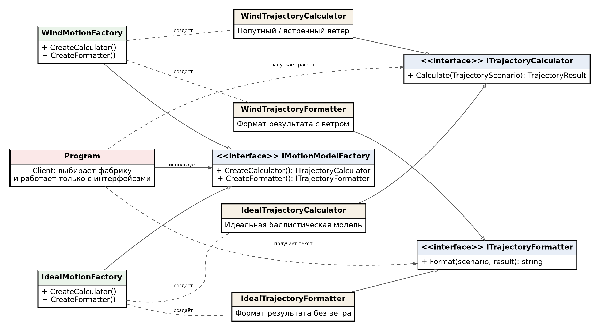
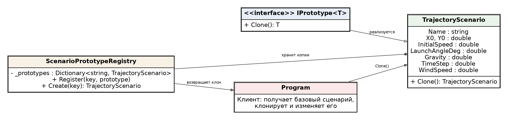
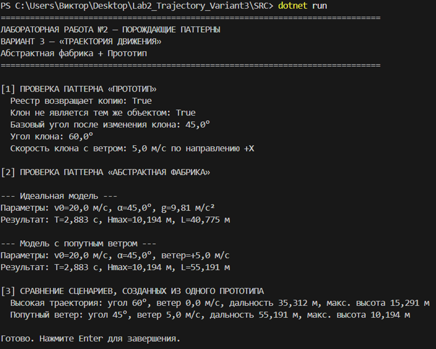

# Лабораторная работа №2

**Дисциплина:** Паттерны проектирования  
**Тема:** Порождающие паттерны: Абстрактная фабрика, Фабричный метод, Прототип  
**Выполнил:** Блинов Виктор Александрович, 4 курс, группа ПИЖ-б-о-23-2  
**Направление подготовки:** 09.03.04 «Программная инженерия», очная форма обучения  
**Проверил:** Белик А. И., ассистент департамента цифровых, робототехнических систем и электроники  
**Учебное заведение:** Северо-Кавказский федеральный университет, Институт перспективной инженерии  
**Место и год:** Ставрополь, 2026 г.

**Оценка за защиту:** ____________  
**Дата защиты:** ____________  
**Подписи:** студент ____________ · преподаватель ____________

---

**Цель работы:** изучить назначение порождающих паттернов и применить два из предложенного перечня при разработке прикладного программного решения. В рамках данного варианта выбраны паттерны «Абстрактная фабрика» и «Прототип».

**Задание:** реализовать приложение из выбранной предметной области в соответствии с вариантом 3 — «Траектория движения».

Согласно методическим указаниям для лабораторной работы №2 требуется использовать два паттерна из списка «Абстрактная фабрика», «Фабричный метод», «Прототип».

В разработанном приложении моделируется движение тела, брошенного под углом к горизонту. Помимо базовой баллистической модели предусмотрена модель с постоянным попутным или встречным ветром, которая отличается способом расчёта горизонтальной координаты.

Для подготовки нескольких близких сценариев используется прототип готового объекта: исходный сценарий клонируется, после чего в копиях изменяются угол запуска или скорость ветра.

## 1. Архитектура решения

Программа разделена на несколько функциональных частей. Класс TrajectoryScenario хранит параметры конкретного запуска и одновременно выступает конкретным прототипом. ScenarioPrototypeRegistry содержит зарегистрированные шаблоны и выдаёт их независимые копии. Интерфейс IMotionModelFactory определяет семейство объектов для выбранной модели движения: калькулятор траектории и форматтер результата. Классы IdealMotionFactory и WindMotionFactory создают соответствующие наборы конкретных продуктов. Клиентский код Program выбирает фабрику, получает продукты по интерфейсам и выполняет расчёт.

- Models – параметры сценария, точки траектории и итог расчёта;

- Patterns – интерфейс Prototype и реестр прототипов;

- Motion – конкретные калькуляторы для разных моделей движения;

- Factories – абстрактная фабрика и две её реализации;

- Presentation – форматтеры результата для соответствующих семейств.

## 2. Используемые технологии

- C# 12 и .NET 8;

- консольный интерфейс без внешних библиотек;

- UML-диаграммы классов для подтверждения структуры паттернов;

- Git-ready структура проекта с отдельными каталогами по ролям классов. **Паттерн «Абстрактная фабрика»**

Абстрактная фабрика используется для создания взаимосвязанного семейства объектов без жёсткой привязки клиентского кода к их конкретным классам.

В программе есть две версии математического моделирования: идеальное движение без ветра и движение с постоянной добавкой к горизонтальной скорости, имитирующей действие ветра.

Для каждой версии формируется пара согласованных продуктов: ITrajectoryCalculator и ITrajectoryFormatter.

Клиент не создаёт IdealTrajectoryCalculator, WindTrajectoryCalculator и соответствующие форматтеры напрямую. Вместо этого он работает с IMotionModelFactory. При замене фабрики меняется всё семейство используемых компонентов, а код запуска расчёта остаётся одинаковым.

Такое решение особенно удобно, если позднее появится третья модель, например движение с ограничением скорости или иной системой координат.

| **Роль**        | **Класс / интерфейс**                                | **Ответственность**                                              |
|-----------------|------------------------------------------------------|------------------------------------------------------------------|
| AbstractFactory | IMotionModelFactory                                  | Задаёт операции создания калькулятора и форматтера одной модели. |
| ConcreteFactory | IdealMotionFactory                                   | Создаёт семейство продуктов для идеальной модели движения.       |
| ConcreteFactory | WindMotionFactory                                    | Создаёт семейство продуктов для модели с ветром.                 |
| AbstractProduct | ITrajectoryCalculator / ITrajectoryFormatter         | Общие интерфейсы взаимосвязанных продуктов.                      |
| ConcreteProduct | IdealTrajectoryCalculator / IdealTrajectoryFormatter | Идеальный расчёт и его представление.                            |
| ConcreteProduct | WindTrajectoryCalculator / WindTrajectoryFormatter   | Расчёт с ветром и его представление.                             |
| Client          | Program                                              | Выбирает фабрику и использует продукты только через интерфейсы.  |

Таблица 1 – Участники паттерна «Абстрактная фабрика»

Рисунок 1 – Диаграмма классов паттерна «Абстрактная фабрика»

```csharp
public interface IMotionModelFactory
{
    ITrajectoryCalculator CreateCalculator();
    ITrajectoryFormatter CreateFormatter();
}
public sealed class WindMotionFactory : IMotionModelFactory
{
    public ITrajectoryCalculator CreateCalculator() =>
    new WindTrajectoryCalculator();
    public ITrajectoryFormatter CreateFormatter() =>
    new WindTrajectoryFormatter();
}
```

*Листинг 1 — Абстрактная фабрика и одна из конкретных фабрик*
## 4. Паттерн «Прототип»

Прототип применяется, когда удобнее копировать уже настроенный объект, чем каждый раз создавать его с нуля и повторно задавать все параметры.

В рассматриваемой задаче базовый сценарий содержит положение старта, скорость, угол, ускорение свободного падения, шаг расчёта и скорость ветра.

После создания исходного сценария можно получить его копию методом Clone(), а затем изменить только необходимые параметры.

Чтобы сделать использование паттерна явным, в проекте присутствует интерфейс IPrototype\<T\> с методом Clone() и реестр ScenarioPrototypeRegistry. При регистрации реестр сохраняет собственную копию сценария.

При последующих вызовах Create() возвращается новая копия, поэтому изменение результата не влияет ни на зарегистрированный образец, ни на ранее созданные экземпляры.

Рисунок 2 – Диаграмма классов паттерна «Прототип»

| **Роль**          | **Класс / интерфейс**     | **Ответственность**                                                     |
|-------------------|---------------------------|-------------------------------------------------------------------------|
| Prototype         | IPrototype\<T\>           | Определяет общий контракт копирования.                                  |
| ConcretePrototype | TrajectoryScenario        | Хранит параметры сценария и создаёт независимую копию через Clone().    |
| PrototypeRegistry | ScenarioPrototypeRegistry | Регистрирует именованные образцы и выдаёт их клоны.                     |
| Client            | Program                   | Получает прототип, создаёт варианты и изменяет только нужные параметры. |

Таблица 2 – Участники паттерна «Прототип»

```csharp
public sealed class TrajectoryScenario : IPrototype<TrajectoryScenario>
{
    // параметры сценария
    public TrajectoryScenario Clone()
    {
        return new TrajectoryScenario(
        Name, X0, Y0, InitialSpeed, LaunchAngleDeg,
        Gravity, TimeStep, WindSpeed);
    }
}
var highArc = baseScenario.Clone();
highArc.LaunchAngleDeg = 60;
var tailwind = baseScenario.Clone();
tailwind.WindSpeed = 5;
```

*Листинг 2 — Реализация прототипа и создание его вариантов*
## 5. Математическая модель движения

Для базовой модели начальная скорость v₀ раскладывается на горизонтальную и вертикальную составляющие. Угол запуска α задаётся в градусах и переводится в радианы перед вычислением тригонометрических функций:

vₓ = v₀ · cos(α)

vᵧ = v₀ · sin(α)

x(t) = x₀ + vₓ · t

y(t) = y₀ + vᵧ · t − g · t² / 2

T = (vᵧ + √(vᵧ² + 2 · g · y₀)) / g

Hmax = y₀ + vᵧ² / (2 · g)

L = x₀ + vₓ · T

Для модели с ветром предполагается постоянная добавка windSpeed к горизонтальной скорости. В этом случае используется формула x(t) = x₀ + (vₓ + v_w) · t.

Вертикальное движение остаётся таким же, поэтому время полёта и максимальная высота не изменяются при чисто горизонтальном ветре, а дальность зависит от его направления и величины.

## 6. Ключевые фрагменты исходного кода

```csharp
var registry = new ScenarioPrototypeRegistry();
registry.Register("base", new TrajectoryScenario(
"Базовый бросок", 0, 0, 20, 45, 9.81, 0.2, 0));
var baseScenario = registry.Create("base");
var highArc = baseScenario.Clone();
highArc.LaunchAngleDeg = 60;
var tailwind = baseScenario.Clone();
tailwind.WindSpeed = 5;
```

*Листинг 3 — Регистрация прототипа и получение его клонов*
```csharp
var factory = new WindMotionFactory();
var calculator = factory.CreateCalculator();
var formatter = factory.CreateFormatter();
var result = calculator.Calculate(tailwind);
Console.WriteLine(formatter.Format(tailwind, result));
```

*Листинг 4 — Клиент использует продукты Abstract Factory через интерфейсы*
## 7. Проверка корректности и ограничения

Калькуляторы проверяют основные ограничения входных данных до начала вычислений. Начальная скорость, ускорение свободного падения и шаг дискретизации должны быть положительными. Угол запуска должен лежать строго между 0 и 90 градусами, а начальная высота не может быть отрицательной.

Такие проверки предотвращают получение математически некорректной или бессмысленной траектории.

Отдельно проверяется семантика Prototype: после изменения клона параметры исходного сценария должны оставаться неизменными.

Для Abstract Factory проверяется, что при выборе WindMotionFactory клиент получает WindTrajectoryCalculator и WindTrajectoryFormatter, а при выборе IdealMotionFactory – соответствующие идеальные реализации.

Таким образом подтверждается замена целого семейства продуктов одной операцией выбора фабрики.

## 8. Результат работы программы

Для демонстрации выбран базовый сценарий: начальная точка (0; 0) м, начальная скорость 20 м/с, угол запуска 45°, ускорение свободного падения 9,81 м/с² и шаг расчёта 0,2 с. Для идеальной модели получаем время полёта около 2.883 с, максимальную высоту 10.194 м и дальность 40.775 м.

Из этого же прототипа создаётся копия «Высокая траектория», где изменён только угол на 60°. Её дальность составляет около 35.312 м, а максимальная высота – 15.291 м. Второй вариант — клон «Попутный ветер» со скоростью ветра +5 м/с. Для него время полёта остаётся 2.883 с и максимальная высота 10.194 м, а дальность увеличивается до 55.191 м. Эти различия показывают, что одна и та же заготовка может быстро превращаться в независимые сценарии.



*Рисунок 3 — Пример вывода консольного приложения*

## 9. Что подтверждает применение паттернов

- ScenarioPrototypeRegistry возвращает независимые копии зарегистрированного сценария;

- метод Clone() создаёт отдельный объект, параметры которого можно менять без изменения исходника;

- клиент выбирает одну фабрику и получает согласованные продукты через общие интерфейсы;

- переключение с IdealMotionFactory на WindMotionFactory не требует изменения алгоритма клиентского кода;

- две модели движения дают согласованные, но различающиеся результаты расчёта.

**Вывод:** В ходе лабораторной работы разработано приложение «Траектория движения» с применением паттернов «Абстрактная фабрика» и «Прототип».

Абстрактная фабрика отделяет клиентский код от конкретных компонентов двух моделей движения, а Prototype позволяет быстро получать независимые варианты настроенного сценария. Решение получилось расширяемым и удобным для сравнительного моделирования.
