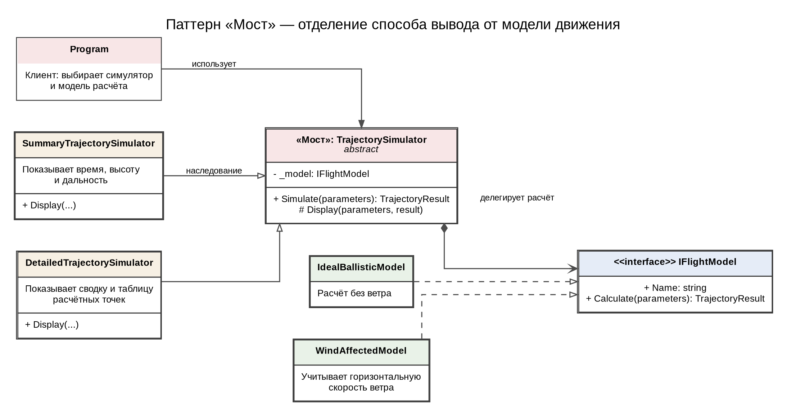
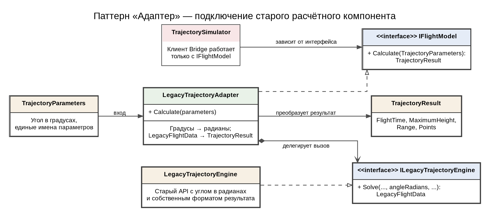
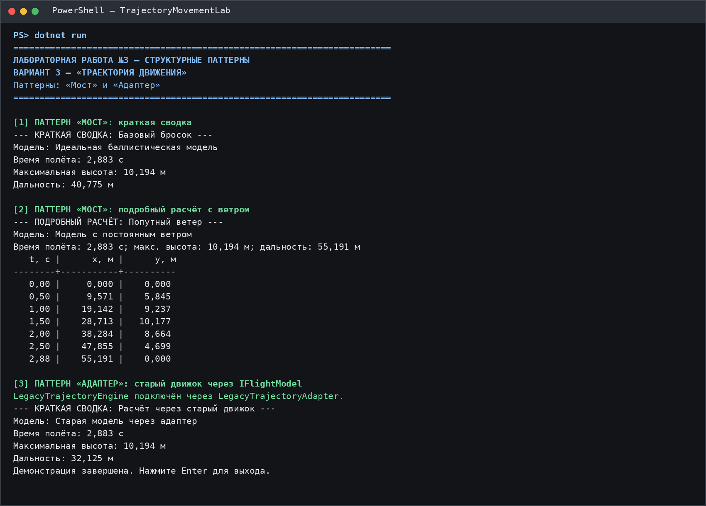

# Лабораторная работа №3

**Дисциплина:** Паттерны проектирования  
**Тема:** Структурные паттерны: Адаптер, Мост  
**Выполнил:** Блинов Виктор Александрович, 4 курс, группа ПИЖ-б-о-23-2  
**Направление подготовки:** 09.03.04 «Программная инженерия», очная форма обучения  
**Проверил:** Белик А. И., ассистент департамента цифровых, робототехнических систем и электроники  
**Учебное заведение:** Северо-Кавказский федеральный университет, Институт перспективной инженерии  
**Место и год:** Ставрополь, 2026 г.

**Оценка за защиту:** ____________  
**Дата защиты:** ____________  
**Подписи:** студент ____________ · преподаватель ____________

---

**Цель работы:** изучить назначение структурных паттернов «Адаптер» и «Мост» и применить их при разработке прикладного программного решения.

**Задание:** реализовать приложение из предметной области согласно варианту 3 — «Траектория движения», используя паттерны из перечня лабораторной работы №3: «Адаптер» и «Мост».

В приложении рассчитывается траектория тела, брошенного под углом к горизонту. Для одной предметной задачи предусмотрены разные способы представления результата и несколько моделей движения. Дополнительно подключён условный прежний расчётный компонент, интерфейс которого отличается от интерфейса новой программы.

Паттерн «Мост» разделяет абстракцию симулятора и реализацию физической модели. Паттерн «Адаптер» позволяет использовать старый расчётный компонент через единый современный интерфейс, не меняя код симулятора.

## 1. Архитектура решения

Программа разделена на предметную модель, физические модели, абстракцию симулятора и адаптер старого компонента. TrajectoryParameters хранит исходные параметры запуска, TrajectoryPoint представляет одну расчётную точку, а TrajectoryResult содержит время полёта, максимальную высоту, дальность и набор точек.

В паттерне «Мост» абстрактный класс TrajectorySimulator содержит ссылку на IFlightModel и передаёт ему выполнение расчёта. Уточнённые абстракции SummaryTrajectorySimulator и DetailedTrajectorySimulator по-разному отображают один и тот же результат. Реализации IdealBallisticModel и WindAffectedModel отличаются только правилами вычисления горизонтального движения.

LegacyTrajectoryAdapter реализует тот же интерфейс IFlightModel, но внутри вызывает старый LegacyTrajectoryEngine. Адаптер преобразует угол из градусов в радианы, передаёт параметры старому API и переводит LegacyFlightData в общий тип TrajectoryResult.

- Models – параметры сценария, точка траектории и результат вычислений;

- Bridge – интерфейс модели движения, реализации моделей и абстракции вывода;

- Adapter – интерфейс старого компонента, сам старый движок и класс-адаптер;

- Validation – проверка диапазонов исходных параметров;

- Program.cs – пример совместной работы паттернов и вывод результата.

## 2. Используемые технологии

- C# 12 и .NET 8;

- консольное приложение без сторонних библиотек;

- UML-диаграммы классов для демонстрации структуры паттернов;

- отдельные каталоги для моделей, паттернов и проверки входных данных.

## 3. Паттерн «Мост»

Паттерн «Мост» применяется, когда две части системы должны изменяться независимо друг от друга. В этой задаче первая изменяемая часть — способ представления результата, а вторая — физическая модель движения. Если объединить все сочетания в один класс, при добавлении новой модели и нового представления пришлось бы создавать дополнительные комбинации подклассов.

Абстракция TrajectorySimulator хранит ссылку на IFlightModel. Метод Simulate() запускает выбранную реализацию расчёта, а виртуальная операция Display() определяет формат показа результата. SummaryTrajectorySimulator выводит только время, высоту и дальность; DetailedTrajectorySimulator дополнительно выводит таблицу координат по времени.

Интерфейс IFlightModel выступает реализацией паттерна (Implementor). IdealBallisticModel рассчитывает движение без ветра, WindAffectedModel прибавляет скорость ветра к горизонтальной составляющей. Любая новая модель, реализующая IFlightModel, может быть подключена к обоим симуляторам без изменения их кода.

| **Роль**             | **Класс / интерфейс**       | **Ответственность**                                                                 |
|----------------------|-----------------------------|-------------------------------------------------------------------------------------|
| Abstraction          | TrajectorySimulator         | Хранит ссылку на IFlightModel, запускает расчёт и определяет общий алгоритм вывода. |
| Refined Abstraction  | SummaryTrajectorySimulator  | Показывает краткую сводку: время полёта, максимальную высоту и дальность.           |
| Refined Abstraction  | DetailedTrajectorySimulator | Показывает сводку и табличные точки траектории.                                     |
| Implementor          | IFlightModel                | Задаёт единый интерфейс расчёта TrajectoryResult.                                   |
| Concrete Implementor | IdealBallisticModel         | Рассчитывает полёт без ветра.                                                       |
| Concrete Implementor | WindAffectedModel           | Учитывает постоянную горизонтальную добавку скорости ветра.                         |
| Client               | Program                     | Выбирает симулятор и модель, не объединяя их в один класс.                          |

Таблица 1 – Участники паттерна «Мост»



*Рисунок 1 — Диаграмма классов паттерна «Мост»*

Диаграмма показывает, что абстракция зависит от интерфейса IFlightModel, а не от конкретных классов расчёта. Поэтому краткое или подробное представление можно сочетать как с идеальной моделью, так и с моделью с ветром.

```csharp
public interface IFlightModel
{
    string Name { get; }
    TrajectoryResult Calculate(TrajectoryParameters parameters);
}
public abstract class TrajectorySimulator
{
    private readonly IFlightModel _model;
    protected TrajectorySimulator(IFlightModel model) => _model = model;
    public TrajectoryResult Simulate(TrajectoryParameters parameters)
    {
        var result = _model.Calculate(parameters);
        Display(parameters, result);
        return result;
    }
    protected abstract void Display(
    TrajectoryParameters parameters, TrajectoryResult result);
}
```

*Листинг 1 — Контракт реализации и основа абстракции паттерна «Мост»*
## 4. Паттерн «Адаптер»

Адаптер используется для совместной работы классов с несовместимыми интерфейсами. Условный старый компонент LegacyTrajectoryEngine принимает угол запуска в радианах и возвращает LegacyFlightData со своими именами полей: FlightSeconds, HighestPointY, LandingCoordinateX и Samples. Современная программа использует градусы и тип TrajectoryResult.

LegacyTrajectoryAdapter реализует целевой интерфейс IFlightModel и содержит ссылку на ILegacyTrajectoryEngine. При вызове Calculate() адаптер проверяет входные данные, переводит угол в радианы, вызывает метод Solve() и преобразует каждую LegacyPoint в TrajectoryPoint. Клиенту не требуется знать о внутреннем устройстве старого компонента.

Важное преимущество решения состоит в том, что адаптер одновременно может использоваться как реализация моста. Благодаря этому старый модуль подходит к существующей абстракции TrajectorySimulator, а переключение на него не требует переписывания логики вывода.



*Рисунок 2 — Диаграмма классов паттерна «Адаптер»*

| **Роль**          | **Класс / интерфейс**         | **Ответственность**                                                    |
|-------------------|-------------------------------|------------------------------------------------------------------------|
| Target            | IFlightModel                  | Целевой интерфейс, ожидаемый современной системой.                     |
| Adapter           | LegacyTrajectoryAdapter       | Реализует Target, переводит единицы и преобразует результат.           |
| Adaptee Interface | ILegacyTrajectoryEngine       | Описывает прежний метод Solve() со старым набором аргументов.          |
| Adaptee           | LegacyTrajectoryEngine        | Выполняет расчёт через исторический API и возвращает LegacyFlightData. |
| Client            | TrajectorySimulator / Program | Использует IFlightModel и не зависит от формата старого результата.    |

Таблица 2 – Участники паттерна «Адаптер»

```csharp
public TrajectoryResult Calculate(TrajectoryParameters parameters)
{
    TrajectoryValidator.Validate(parameters);
    double radians = parameters.LaunchAngleDeg * Math.PI / 180.0;
    LegacyFlightData oldData = _legacyEngine.Solve(
    parameters.StartX, parameters.StartY, parameters.InitialSpeed,
    radians, parameters.Gravity, parameters.WindSpeed,
    parameters.TimeStep);
    var points = oldData.Samples.Select(s => new TrajectoryPoint(
    s.SecondsElapsed, s.XCoordinate, s.HeightMeters)).ToArray();
    return new TrajectoryResult(Name, oldData.FlightSeconds,
    oldData.HighestPointY, oldData.LandingCoordinateX, points);
}
```

*Листинг 2 — Преобразование вызова и результата в классе-адаптере*
## 5. Математическая модель движения

Начальная скорость v₀ раскладывается на горизонтальную и вертикальную составляющие. Угол α задаётся в градусах, а тригонометрические функции вычисляются после перевода угла в радианы. При постоянной скорости ветра w горизонтальное движение определяется с учётом дополнительной составляющей.

vₓ = v₀ · cos(α)

vᵧ = v₀ · sin(α)

x(t) = x₀ + (vₓ + w) · t

y(t) = y₀ + vᵧ · t − g · t² / 2

T = (vᵧ + √(vᵧ² + 2 · g · y₀)) / g

Hmax = y₀ + vᵧ² / (2 · g)

L = x₀ + (vₓ + w) · T

Для идеальной модели w = 0. Для модели с ветром величина w может быть положительной (попутный ветер) или отрицательной (встречный ветер). При принятой упрощённой модели ветер влияет на дальность, но не влияет на время полёта и максимальную высоту. Сопротивление воздуха и изменение ветра во времени не моделируются.

Старый компонент ожидает угол в радианах, поэтому адаптер использует преобразование αрад = αград · π / 180. Расчётная часть при этом остаётся единой для пользователя приложения.

## 6. Ключевые фрагменты исходного кода

```csharp
var p = new TrajectoryParameters(
"Базовый бросок", 0, 0, 20, 45, 9.81, 0.5, 0);
new SummaryTrajectorySimulator(new IdealBallisticModel())
    .Simulate(p);
var windy = p with { Name = "Попутный ветер", WindSpeed = 5 };
new DetailedTrajectorySimulator(new WindAffectedModel())
    .Simulate(windy);
var adapter = new LegacyTrajectoryAdapter(new LegacyTrajectoryEngine());
new DetailedTrajectorySimulator(adapter).Simulate(
p with { Name = "Старый API", WindSpeed = -3 });
```

*Листинг 3 — Независимый выбор представления и физической модели*
## 7. Проверка корректности и ограничения

Перед расчётом TrajectoryValidator проверяет корректность основных параметров. Начальная скорость, ускорение свободного падения и шаг дискретизации должны быть положительными; угол запуска должен находиться строго между 0° и 90°; начальная высота не может быть отрицательной. Проверяется также, что числовые значения являются конечными.

Для паттерна «Мост» проверяется совместимость разных сочетаний: краткий симулятор с идеальной моделью и подробный симулятор с моделью ветра. В обоих случаях используется один и тот же контракт IFlightModel, а вид представления не меняет физические формулы.

Для паттерна «Адаптер» в расчёт передаются параметры современного формата. Адаптер преобразует угол в радианы, вызывает старый метод Solve() и возвращает объект TrajectoryResult. Далее симулятор обрабатывает результат тем же способом, что и для других моделей.

Решение имеет учебное ограничение: LegacyTrajectoryEngine — локально реализованный пример устаревшего API, введённый для демонстрации несовместимого интерфейса. Он моделирует ту же баллистическую задачу и не является подключением внешней библиотеки.

## 8. Результат работы программы

Для демонстрации используется начальная точка (0; 0) м, скорость 20 м/с, угол запуска 45°, ускорение свободного падения 9,81 м/с² и шаг вывода 0,5 с. При идеальной модели время полёта составляет около 2,883 с, максимальная высота — 10,194 м, дальность — 40,775 м.

В варианте с попутным ветром +5 м/с вертикальное движение не меняется, а дальность увеличивается до 55,191 м. При использовании старого компонента через адаптер с ветром −3 м/с результат по дальности составляет около 32,125 м. Пример вывода консоли показан на рисунке 3.

| **Модель**                  | **Ветер, м/с** | **Время, с** | **Высота, м** | **Дальность, м** |
|-----------------------------|----------------|--------------|---------------|------------------|
| Идеальная баллистическая    | 0              | 2,883        | 10,194        | 40,775           |
| С постоянным ветром         | +5             | 2,883        | 10,194        | 55,191           |
| Старый движок через Adapter | −3             | 2,883        | 10,194        | 32,125           |

Таблица 3 – Сравнение результатов для трёх вариантов расчёта



*Рисунок 3 — Пример консольного вывода приложения*

## 9. Что подтверждает применение паттернов

- TrajectorySimulator зависит от интерфейса IFlightModel, а не от конкретной модели; это подтверждает структуру паттерна «Мост»;

- SummaryTrajectorySimulator и DetailedTrajectorySimulator используют разные способы отображения одних и тех же результатов;

- IdealBallisticModel и WindAffectedModel могут заменять друг друга без изменения алгоритма симулятора;

- LegacyTrajectoryAdapter реализует IFlightModel и переводит параметры и результат старого API в формат нового приложения;

- подключение старого движка не требует изменения клиентского кода или классов представления.

**Вывод:** В ходе лабораторной работы разработано приложение «Траектория движения» с применением структурных паттернов «Мост» и «Адаптер». Паттерн «Мост» разделяет способ представления результатов и физическую модель движения, а «Адаптер» позволяет использовать прежний расчётный компонент через единый интерфейс IFlightModel. Такое построение уменьшает связанность классов и упрощает расширение программы новыми моделями и режимами отображения.
