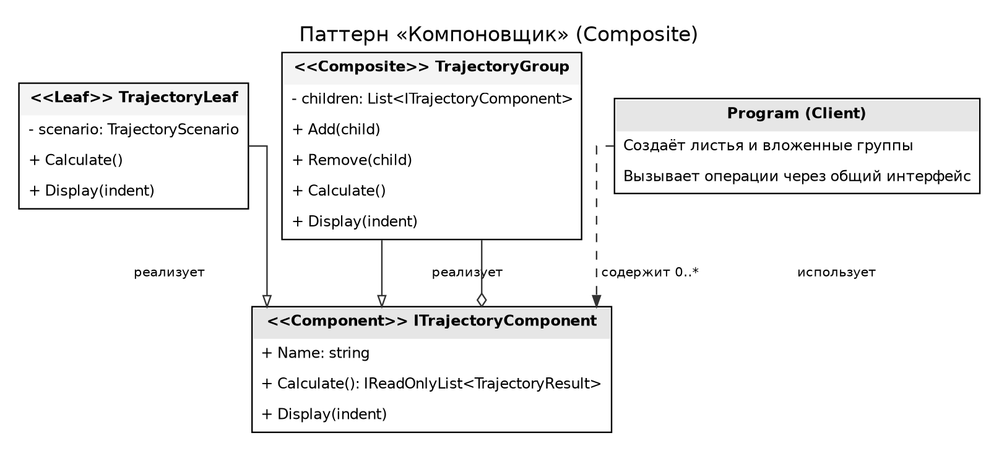
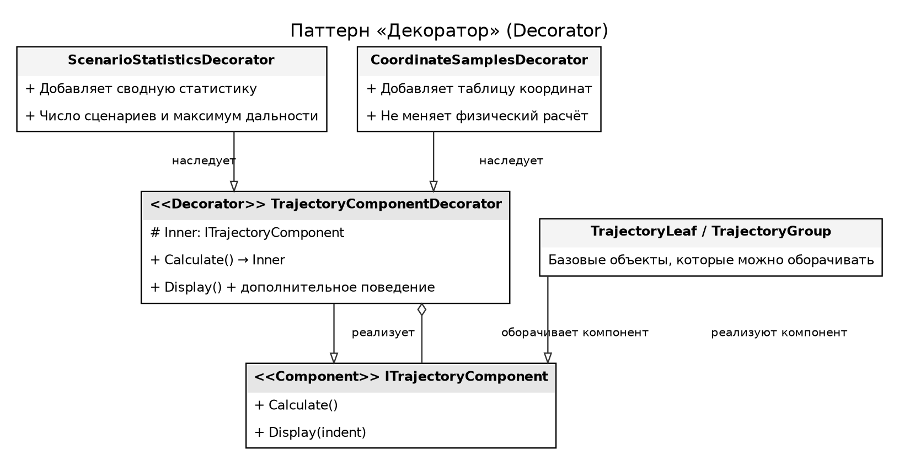
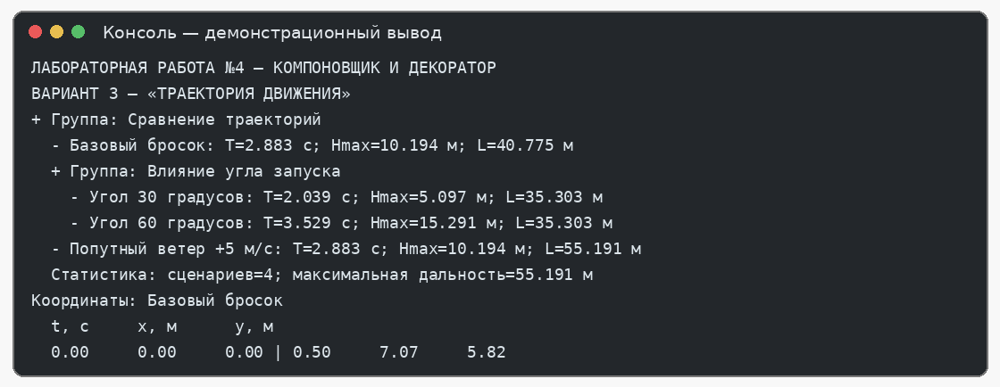

# Лабораторная работа №4

**Дисциплина:** Паттерны проектирования  
**Тема:** Структурные паттерны: Компоновщик, Декоратор  
**Выполнил:** Блинов Виктор Александрович, 4 курс, группа ПИЖ-б-о-23-2  
**Направление подготовки:** 09.03.04 «Программная инженерия», очная форма обучения  
**Проверил:** Белик А. И., ассистент департамента цифровых, робототехнических систем и электроники  
**Учебное заведение:** Северо-Кавказский федеральный университет, Институт перспективной инженерии  
**Место и год:** Ставрополь, 2026 г.

**Оценка за защиту:** ____________  
**Дата защиты:** ____________  
**Подписи:** студент ____________ · преподаватель ____________

---

**Цель работы:** изучить назначение структурных паттернов «Компоновщик» и «Декоратор» и применить их при разработке прикладного программного решения.

**Задание:** реализовать приложение предметной области согласно варианту 3 — «Траектория движения», используя паттерны, указанные для лабораторной работы №4: «Компоновщик» и «Декоратор».

Приложение моделирует движение тела, брошенного под углом к горизонту. Пользователь может сравнивать одиночные сценарии, объединять их во вложенные группы и получать общий результат по набору траекторий. Для той же структуры предусмотрены дополнительные действия по выводу статистики и координатных выборок.

Паттерн «Компоновщик» позволяет работать с отдельным сценарием и группой сценариев через единый интерфейс. Паттерн «Декоратор» добавляет к компоненту новые функции отображения без изменения класса сценария или группы.

## 1. Архитектура решения

Предметные данные представлены классами TrajectoryScenario, TrajectoryPoint и TrajectoryResult. Статический TrajectoryCalculator проверяет параметры и рассчитывает время полёта, максимальную высоту, дальность и набор координат. Интерфейс ITrajectoryComponent задаёт единый контракт для листа и составного объекта.

Класс TrajectoryLeaf соответствует одному запуску и возвращает один результат. TrajectoryGroup хранит набор объектов ITrajectoryComponent, поэтому внутри группы могут находиться как отдельные сценарии, так и другие группы. Декораторы ScenarioStatisticsDecorator и CoordinateSamplesDecorator оборачивают готовый компонент и дополняют его вывод, сохраняя базовый интерфейс.

- Models – параметры сценария, расчётные точки, результаты и математический расчёт;

- Composite – общий интерфейс, лист TrajectoryLeaf и группа TrajectoryGroup;

- Decorators – базовый декоратор, сводная статистика и таблица координат;

- UML – диаграммы классов паттернов «Компоновщик» и «Декоратор»;

- Program.cs – построение иерархии и демонстрация расширенного вывода.

## 2. Используемые технологии

- C# 12 и .NET 8;

- консольный интерфейс без внешних библиотек;

- UML-диаграммы классов для демонстрации ролей структурных паттернов;

- разделение предметной модели, композиции объектов и расширений вывода по отдельным каталогам.

## 3. Паттерн «Компоновщик»

Компоновщик применяется, когда элементы требуется объединять в древовидную структуру и обращаться к ним единообразно. В приложении дерево отражает организацию экспериментов: корневая группа сравнивает набор траекторий, вложенная группа объединяет варианты с разными углами запуска, а листья представляют отдельные расчёты.

ITrajectoryComponent является общим интерфейсом (Component). TrajectoryLeaf – лист (Leaf), который рассчитывает одну TrajectoryScenario. TrajectoryGroup – компоновщик (Composite): методы Add() и Remove() управляют дочерними объектами, а Calculate() объединяет результаты всех потомков. Клиентский код не обязан выяснять, является выбранный объект листом или группой.

| **Роль**  | **Класс / интерфейс** | **Ответственность**                                                              |
|-----------|-----------------------|----------------------------------------------------------------------------------|
| Component | ITrajectoryComponent  | Общий контракт Name, Calculate() и Display() для листьев и групп.                |
| Leaf      | TrajectoryLeaf        | Рассчитывает одну траекторию и возвращает один результат.                        |
| Composite | TrajectoryGroup       | Хранит дочерние компоненты, поддерживает Add()/Remove() и агрегирует результаты. |
| Client    | Program               | Строит иерархию и использует общий интерфейс.                                    |

Таблица 1 – Участники паттерна «Компоновщик»



*Рисунок 1 — Диаграмма классов паттерна «Компоновщик»*

На диаграмме общий контракт показан отдельно от конкретных узлов. Группа хранит несколько компонентов того же интерфейса, что позволяет создавать вложенные деревья любой разумной глубины и собирать результаты рекурсивно.

```csharp
public interface ITrajectoryComponent
{
    string Name { get; }
    IReadOnlyList<TrajectoryResult> Calculate();
    void Display(int indent = 0);
}
public void Add(ITrajectoryComponent child)
{
    ArgumentNullException.ThrowIfNull(child);
    _children.Add(child);
}
public IReadOnlyList<TrajectoryResult> Calculate() =>
    _children.SelectMany(child => child.Calculate()).ToArray();
```

*Листинг 1 — Общий интерфейс и агрегирование дочерних объектов*
## 4. Паттерн «Декоратор»

Декоратор позволяет динамически дополнять объект ответственностью, не создавая отдельные подклассы для каждой комбинации функций. В данной реализации исходный компонент отвечает за расчёт и базовый вывод. Декоратор хранит ссылку на ITrajectoryComponent и передаёт ему основные операции, а после базового вывода выполняет дополнительное действие.

ScenarioStatisticsDecorator выводит число сценариев в компоненте и максимальную найденную дальность. CoordinateSamplesDecorator выводит координатную таблицу первых точек первого сценария. Декораторы можно комбинировать: сначала добавить сводку, а затем расширить результат координатной выборкой. Расчётная модель при этом остаётся прежней.

| **Роль**          | **Класс / интерфейс**            | **Ответственность**                                                  |
|-------------------|----------------------------------|----------------------------------------------------------------------|
| Component         | ITrajectoryComponent             | Определяет общий интерфейс объектов, которые допускают оборачивание. |
| ConcreteComponent | TrajectoryLeaf / TrajectoryGroup | Выполняют исходные расчёты или объединяют дочерние результаты.       |
| Decorator         | TrajectoryComponentDecorator     | Хранит ссылку на компонент и делегирует Calculate()/Display().       |
| ConcreteDecorator | ScenarioStatisticsDecorator      | Добавляет сводную статистику по набору сценариев.                    |
| ConcreteDecorator | CoordinateSamplesDecorator       | Добавляет таблицу координат без изменения математической модели.     |
| Client            | Program                          | Сочетает декораторы в нужном порядке.                                |

Таблица 2 – Участники паттерна «Декоратор»



*Рисунок 2 — Диаграмма классов паттерна «Декоратор»*

В отличие от наследования ради каждой возможной комбинации, декораторы составляются из отдельных объектов. Это позволяет включать либо отключать статистику и подробную таблицу координат без правок классов TrajectoryLeaf и TrajectoryGroup.

```csharp
public void Display(int indent = 0)
{
    Inner.Display(indent);
    DisplaySupplement(Calculate(), indent);
}
protected override void DisplaySupplement(
IReadOnlyList<TrajectoryResult> results, int indent)
{
    if (results.Count == 0) return;
    Console.WriteLine($"Сценариев: {results.Count}; " +
    $"максимальная дальность: {results.Max(r => r.RangeMeters):F3} м");
}
```

*Листинг 2 — Передача базового вывода и добавление статистики декоратором*
## 5. Математическая модель движения

Для начальной скорости v₀ и угла запуска α вычисляются горизонтальная и вертикальная составляющие скорости. Угол перед вычислением тригонометрических функций переводится из градусов в радианы. В модели учитывается постоянная добавка скорости ветра w по горизонтали; сопротивление воздуха не моделируется.

vₓ = v₀ · cos(α)

vᵧ = v₀ · sin(α)

x(t) = x₀ + (vₓ + w) · t

y(t) = y₀ + vᵧ · t − g · t² / 2

T = (vᵧ + √(vᵧ² + 2 · g · y₀)) / g

Hmax = y₀ + vᵧ² / (2 · g)

L = (vₓ + w) · T

Время полёта определяется положительным корнем уравнения y(t) = 0. Горизонтальная скорость ветра влияет на дальность, но в принятой модели не меняет время полёта и максимальную высоту. Все компоненты композиции используют один и тот же расчёт, поэтому группировка объектов не меняет физический результат.

## 6. Ключевые фрагменты исходного кода

```csharp
var root = new TrajectoryGroup("Сравнение траекторий");
root.Add(new TrajectoryLeaf(
new TrajectoryScenario("Базовый бросок", 20, 45)));
var angles = new TrajectoryGroup("Влияние угла запуска");
angles.Add(new TrajectoryLeaf(
new TrajectoryScenario("Угол 30 градусов", 20, 30)));
angles.Add(new TrajectoryLeaf(
new TrajectoryScenario("Угол 60 градусов", 20, 60)));
root.Add(angles);
ITrajectoryComponent report = new CoordinateSamplesDecorator(
new ScenarioStatisticsDecorator(root));
report.Display();
```

*Листинг 3 — Построение вложенной композиции и комбинирование декораторов*
## 7. Проверка корректности и ограничения

Перед расчётом проверяются название сценария, конечность и допустимость числовых параметров. Начальная скорость, ускорение свободного падения и шаг дискретизации должны быть положительными; угол запуска должен находиться строго между 0° и 90°; начальная высота не может быть отрицательной. При нарушении ограничений расчёт завершается понятным исключением.

Для паттерна «Компоновщик» проверяется, что корневая группа содержит как отдельные листья, так и вложенную группу, а число итоговых результатов совпадает с числом листьев. Для паттерна «Декоратор» подтверждается, что добавление статистики и координатного вывода не меняет рассчитанные значения времени полёта, максимальной высоты и дальности.

Ограничение математической модели состоит в отсутствии сопротивления воздуха и изменяющегося во времени ветра. Оно не влияет на демонстрацию структурных паттернов, но задаёт границы физической точности приложения.

## 8. Результат работы программы

Для сравнения используются четыре сценария: базовый бросок под углом 45°, два варианта с углами 30° и 60°, а также базовый бросок с попутным ветром +5 м/с. При v₀ = 20 м/с и g = 9,81 м/с² расчёт даёт следующие ориентировочные значения:

| **Сценарий**          | **Ветер, м/с** | **Время, с** | **Высота, м** | **Дальность, м** |
|-----------------------|----------------|--------------|---------------|------------------|
| Базовый бросок, 45°   | 0              | 2,883        | 10,194        | 40,775           |
| Угол запуска 30°      | 0              | 2,039        | 5,097         | 35,303           |
| Угол запуска 60°      | 0              | 3,529        | 15,291        | 35,303           |
| Попутный ветер +5 м/с | +5             | 2,883        | 10,194        | 55,191           |

Таблица 3 – Сравнение результатов четырёх сценариев



*Рисунок 3 — Пример вывода программы с компоновщиком и декораторами*

## 9. Что подтверждает применение паттернов

- TrajectoryLeaf и TrajectoryGroup используют общий ITrajectoryComponent, поэтому клиент обрабатывает одиночные и составные объекты одинаково;

- TrajectoryGroup способен содержать другие группы, а Calculate() собирает результаты всех потомков;

- ScenarioStatisticsDecorator и CoordinateSamplesDecorator добавляют разные функции без изменения базовых классов;

- декораторы можно комбинировать последовательно, а физический расчёт остаётся неизменным;

- проверка параметров исключает заведомо некорректные исходные значения.

**Вывод:** в лабораторной работе разработано консольное приложение «Траектория движения» с применением структурных паттернов «Компоновщик» и «Декоратор».

Компоновщик организует сценарии в дерево и обеспечивает агрегирование результатов, а декораторы расширяют вывод статистикой и координатными данными.

Такое решение упрощает работу с наборами экспериментов и позволяет добавлять функции отображения независимо от физической модели.
