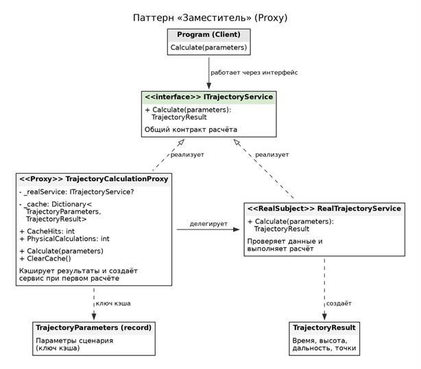
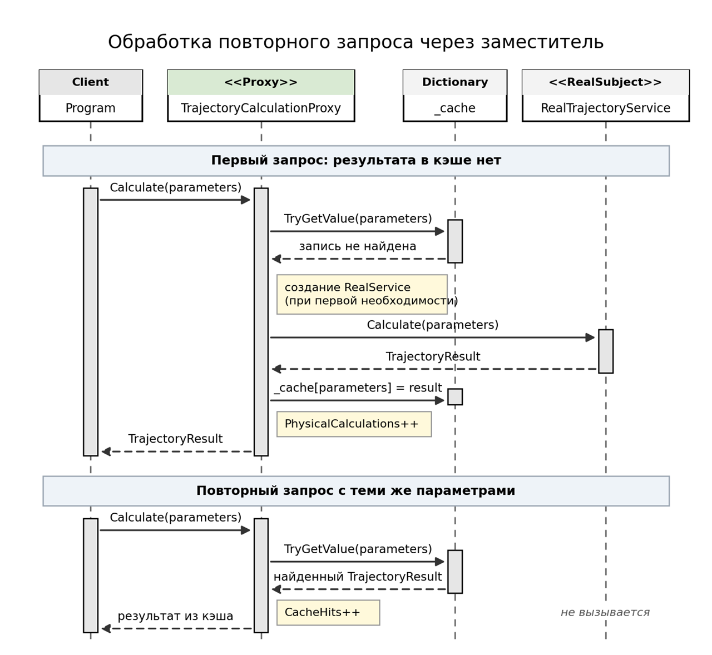
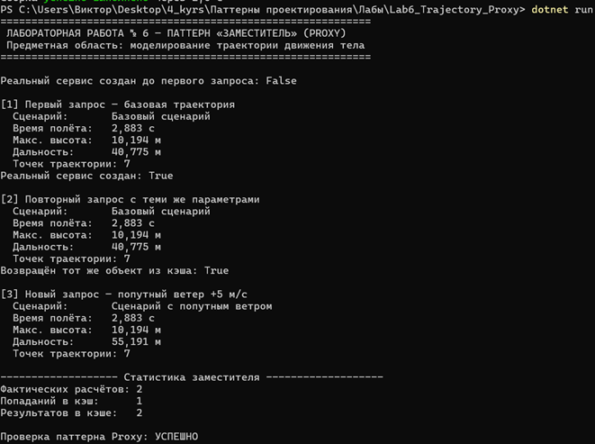

**Дисциплина:** Паттерны проектирования  
**Тема:** Структурный паттерн: Заместитель 
**Выполнил:** Блинов Виктор Александрович, 4 курс, группа ПИЖ-б-о-23-2  
**Направление подготовки:** 09.03.04 «Программная инженерия», очная форма обучения  
**Проверил:** Белик А. И., ассистент департамента цифровых, робототехнических систем и электроники  
**Учебное заведение:** Северо-Кавказский федеральный университет, Институт перспективной инженерии  
**Место и год:** Ставрополь, 2026 г.

**Оценка за защиту:** ____________  
**Дата защиты:** ____________  
**Подписи:** студент ____________ · преподаватель ____________


# Лабораторная работа 6. Структурный паттерн «Заместитель»

Цель работы: изучить назначение структурного паттерна «Заместитель» и применить его для организации контролируемого доступа к вычислительной подсистеме в прикладном программном решении.

Задание: разработать приложение предметной области согласно варианту 3 – «Траектория движения» – с использованием паттерна «Заместитель».

В приложении выполняется моделирование движения тела, брошенного под углом к горизонту. Для заданных параметров рассчитываются время полёта, максимальная высота, дальность и координаты тела в различные моменты времени.

Расчёт траектории может быть вычислительно затратной операцией, особенно при большом количестве сценариев и малом шаге дискретизации. Если пользователь повторно запрашивает расчёт с теми же параметрами, повторное выполнение математических операций не требуется. Для решения этой задачи используется паттерн «Заместитель» с кэшированием результатов.

Заместитель реализует тот же интерфейс, что и реальный расчётный объект. При первом обращении он передаёт запрос вычислительной подсистеме, сохраняет результат и возвращает его клиенту. При повторном запросе с идентичными параметрами возвращается сохранённый результат.

## 1. Архитектура решения

Приложение разделено на предметную модель, проверку входных параметров, расчётную подсистему и объект-заместитель.

Класс TrajectoryParameters хранит параметры запуска: название сценария, начальные координаты, скорость, угол запуска, ускорение свободного падения, шаг расчёта и скорость ветра. Классы TrajectoryPoint и TrajectoryResult описывают координатные точки и итоговые характеристики движения.

Интерфейс ITrajectoryService задаёт единый контракт вычисления траектории. Его реализуют два класса: RealTrajectoryService, выполняющий математический расчёт, и TrajectoryCalculationProxy, контролирующий обращение к реальному объекту и повторное использование результатов.

Основные компоненты:

- Models – параметры сценария, координаты и результат вычислений;

- Core – проверка данных и непосредственный расчёт траектории;

- Proxy – заместитель с кэшированием результатов;

- Program.cs – клиентский код, использующий единый интерфейс.

В клиентской программе не требуется создавать реальный расчётный объект или управлять его кэшем напрямую. Достаточно создать заместитель и вызвать метод Calculate().

## 2. Используемые технологии

- C# 12 и .NET 8;

- консольный интерфейс без сторонних библиотек;

- объектно-ориентированная архитектура;

- интерфейс для унификации доступа к расчётной подсистеме;

- Dictionary для хранения кэшированных результатов;

- UML-диаграммы классов и последовательности вызовов.

## 3. Паттерн «Заместитель»

Паттерн «Заместитель» (Proxy) предоставляет объект, который управляет доступом к другому объекту, сохраняя совместимый с ним интерфейс. Клиент работает с заместителем и не зависит от деталей создания, хранения или вызова реального объекта.

В разрабатываемом приложении интерфейс ITrajectoryService выступает общим контрактом. Он содержит метод Calculate(), принимающий параметры движения и возвращающий результат расчёта.

Класс RealTrajectoryService выполняет основные вычисления: определяет составляющие начальной скорости, время полёта, максимальную высоту, дальность и набор координатных точек.

Класс TrajectoryCalculationProxy реализует тот же интерфейс. Внутри него находится ссылка на реальный сервис и словарь кэшированных результатов. Ключом словаря служит объект параметров сценария. Поскольку TrajectoryParameters является записью C# (record), сравнение ключей выполняется по значениям полей.

При вызове метода Calculate() заместитель проверяет наличие результата в кэше. Если результат существует, он возвращается без повторного обращения к реальному сервису. Если подходящей записи нет, заместитель создаёт реальный сервис при первом необходимости, выполняет расчёт, сохраняет результат и возвращает его клиенту.

Таким образом, паттерн выполняет две функции: отложенное создание реального расчётного объекта и кэширование результатов.

| Роль | Класс / интерфейс | Ответственность |

| --- | --- | --- |

| Subject | ITrajectoryService | Определяет общий интерфейс расчёта траектории. |

| RealSubject | RealTrajectoryService | Проверяет исходные данные и выполняет математические вычисления. |

| Proxy | TrajectoryCalculationProxy | Контролирует доступ к реальному сервису и кэширует результаты. |

| Model | TrajectoryParameters | Хранит исходные параметры сценария. |

| Result | TrajectoryResult | Содержит время полёта, высоту, дальность и координатные точки. |

| Client | Program | Вызывает расчёт через интерфейс ITrajectoryService. |

*Таблица 1 – Участники паттерна «Заместитель»*



*Рисунок 1 – Диаграмма классов паттерна «Заместитель»*

На диаграмме показана реализация интерфейса ITrajectoryService классами RealTrajectoryService и TrajectoryCalculationProxy, а также зависимость заместителя от реального сервиса и кэша результатов.

```csharp

public interface ITrajectoryService
{
    TrajectoryResult Calculate(TrajectoryParameters parameters);
}

```

*Листинг 1 – Интерфейс расчётной подсистемы*

Оба класса реализуют этот интерфейс. Благодаря этому клиент может использовать реальный сервис или заместитель без изменения логики вызова.

```csharp

public sealed class TrajectoryCalculationProxy
    : ITrajectoryService
{
    private ITrajectoryService? _realService;

    private readonly Dictionary<
        TrajectoryParameters,
        TrajectoryResult> _cache = new();

    public int CacheHits { get; private set; }

    public int PhysicalCalculations { get; private set; }

    private ITrajectoryService RealService =>
        _realService ??= new RealTrajectoryService();

    public TrajectoryResult Calculate(
        TrajectoryParameters parameters)
    {
        if (_cache.TryGetValue(parameters, out var cached))
        {
            CacheHits++;
            return cached;
        }

        var result = RealService.Calculate(parameters);

        _cache[parameters] = result;
        PhysicalCalculations++;

        return result;
    }

    public void ClearCache()
    {
        _cache.Clear();
    }
}

```

*Листинг 2 – Реализация заместителя*

В данном фрагменте RealService создаётся только при первом запросе, требующем фактического вычисления. При наличии результата в словаре метод возвращает кэшированное значение.

Счётчик CacheHits показывает количество обращений, обработанных без повторного расчёта. Счётчик PhysicalCalculations отражает количество успешно выполненных вычислений реальной подсистемой. Метод ClearCache() позволяет очистить сохранённые результаты.

## 4. Математическая модель движения

Для расчёта используется упрощённая модель движения тела, брошенного под углом к горизонту. Сопротивление воздуха не учитывается, а скорость ветра считается постоянной и влияет только на горизонтальное движение.

Начальная скорость v₀ раскладывается на две составляющие:

\[vₓ = v₀ · cos(α)\]

\[vᵧ = v₀ · sin(α)\]

Горизонтальная координата в момент времени t:

\[x(t) = x₀ + (vₓ + w) · t\]

Вертикальная координата:

\[y(t) = y₀ + vᵧ · t − g · t² / 2\]

где w – горизонтальная скорость ветра, g – ускорение свободного падения.

Время до достижения земли определяется положительным корнем уравнения y(t) = 0:

\[T = (vᵧ + √(vᵧ² + 2 · g · y₀)) / g\]

Максимальная высота:

\[Hmax = y₀ + vᵧ² / (2 · g)\]

Дальность:

\[L = x₀ + (vₓ + w) · T\]

Заместитель не изменяет формулы движения. Его задача заключается в управлении доступом к расчёту и повторном использовании уже полученных результатов.

## 5. Ключевые фрагменты исходного кода

```csharp

ITrajectoryService service = new TrajectoryCalculationProxy();

var parameters = new TrajectoryParameters("Базовый бросок",
    0, 0,
    20, 45,
    9.81, 0.5,
    0);

var first = service.Calculate(parameters);
var second = service.Calculate(parameters);

Console.WriteLine(
    $"Дальность: {first.Range:F3} м");

Console.WriteLine(
    $"Повторный запрос использует тот же результат: " +
    $"{ReferenceEquals(first, second)}");

```

*Листинг 3 – Использование заместителя клиентом*

Клиент обращается к объекту через интерфейс ITrajectoryService и не вызывает RealTrajectoryService непосредственно. Два одинаковых запроса позволяют проверить кэширование.



*Рисунок 2 – Диаграмма последовательности обработки повторного запроса*

На диаграмме отражены первый вызов Calculate(), проверка кэша, обращение к реальному сервису, сохранение результата и второй вызов, при котором результат возвращается непосредственно из кэша.

## 6. Проверка корректности и ограничения

Перед выполнением вычислений реальный сервис должен проверять входные данные. Название сценария должно быть задано, числовые значения — конечными, скорость, ускорение свободного падения и шаг расчёта — положительными. Угол запуска должен находиться строго между 0° и 90°, начальная высота не должна быть отрицательной.

Для проверки паттерна выполняются следующие действия:

- Создаётся заместитель, через который рассчитывается базовая траектория.

- Повторно передаются те же параметры.

- Проверяется, что второй запрос увеличивает CacheHits, но не увеличивает PhysicalCalculations.

- Создаётся новый сценарий с другой скоростью ветра.

- Проверяется, что для новых параметров выполняется отдельный расчёт и сохраняется отдельный результат.

Ключ кэша включает все поля TrajectoryParameters, в том числе название сценария. Поэтому два сценария с разными названиями считаются разными запросами даже в том случае, когда их физические параметры совпадают.

Кэш рассчитан на повторное использование результатов в рамках одного процесса. Для многопоточной работы потребуется дополнительно обеспечить потокобезопасный доступ к словарю и согласованную инициализацию реального сервиса.

## 7. Результат работы программы

Для демонстрации используется базовый сценарий со следующими параметрами: начальная точка (0; 0) м, скорость 20 м/с, угол запуска 45°, ускорение свободного падения 9,81 м/с² и шаг расчёта 0,5 с.

Для базовой траектории время полёта составляет приблизительно 2,883 с, максимальная высота – 10,194 м, дальность – 40,775 м.

При повторном запросе с теми же параметрами значения характеристик не меняются, поскольку результат извлекается из кэша. Для сценария с попутным ветром +5 м/с выполняется отдельное вычисление, и дальность увеличивается приблизительно до 55,191 м.



*Рисунок 3 – Результат работы программы*

| Запрос | Ветер, м/с | Время полёта, с | Максимальная высота, м | Дальность, м |

| --- | --- | --- | --- | --- |

| Базовый сценарий | 0 | 2,883 | 10,194 | 40,775 |

| Повтор базового сценария | 0 | 2,883 | 10,194 | 40,775 |

| Сценарий с попутным ветром | +5 | 2,883 | 10,194 | 55,191 |

*Таблица 2 – Пример результатов*

При первом запуске базового сценария выполняется реальный расчёт. Второй запрос с полностью идентичными параметрами обслуживается кэшем. Третий запрос имеет другую скорость ветра и требует нового вычисления.

После выполнения последовательности из трёх запросов ожидается два фактических расчёта и одно попадание в кэш.

## 8. Что подтверждает применение паттерна

- TrajectoryCalculationProxy реализует тот же интерфейс, что и RealTrajectoryService.

- Клиент взаимодействует с расчётной системой через ITrajectoryService.

- Реальный сервис создаётся только при необходимости выполнить расчёт.

- При повторной передаче идентичных параметров результат возвращается из кэша.

- Новый сценарий с другими параметрами рассчитывается отдельно.

- Математическая модель не зависит от наличия заместителя.

Вывод: в ходе лабораторной работы разработана модель приложения «Траектория движения» с применением структурного паттерна «Заместитель». Реальный сервис отвечает за проверку исходных данных и вычисление характеристик движения, а заместитель предоставляет совместимый интерфейс и управляет обращением к вычислительной подсистеме.

Кэширование позволяет избежать повторных вычислений при поступлении одинаковых запросов, а отложенное создание реального сервиса исключает его преждевременную инициализацию. В результате клиентский код остаётся простым, обязанности классов разделены, а приложение получает возможность эффективнее обрабатывать повторяющиеся сценарии движения.
