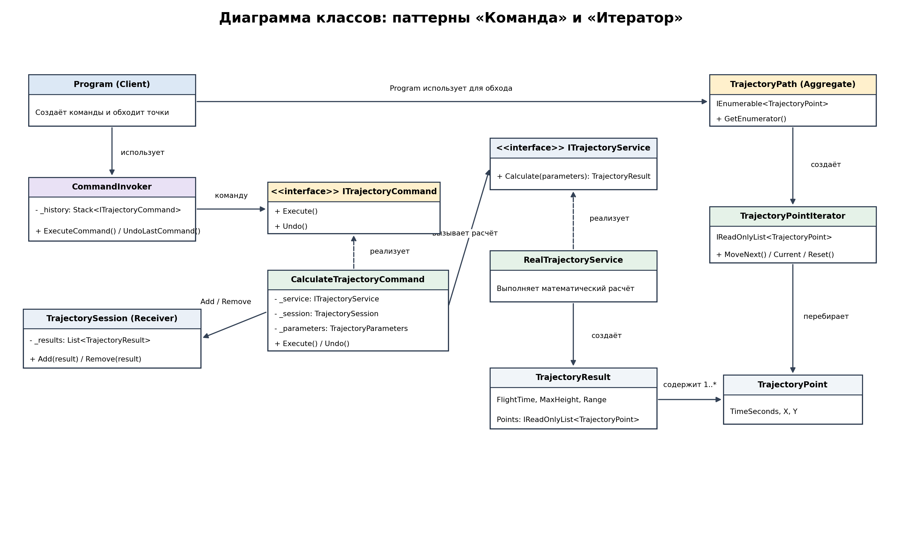
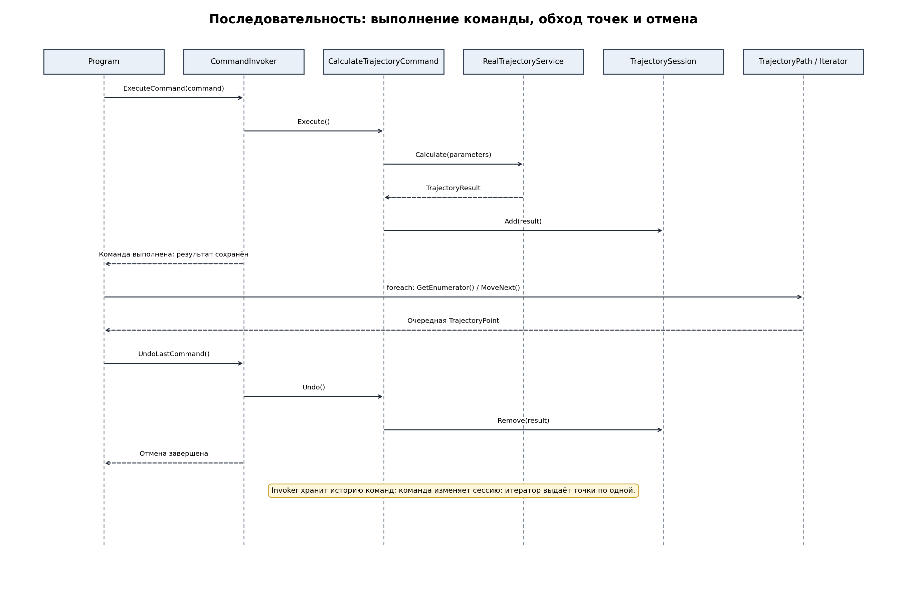
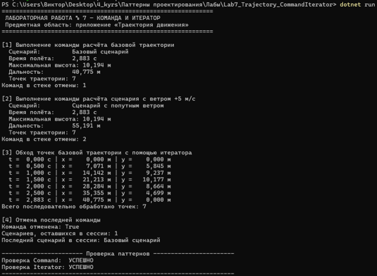

# Лабораторная работа 7. Поведенческие паттерны: «Команда», «Итератор»

**Министерство науки и высшего образования Российской Федерации**  
**Северо-Кавказский федеральный университет**  
Институт перспективной инженерии  
Департамент цифровых, робототехнических систем и электроники  

**Выполнил:** Блинов Виктор Александрович, 4 курс, группа ПИЖ-б-о-23-2, 09.03.04 «Программная инженерия», очная форма обучения  
**Проверил:** Белик А.И.  
Ставрополь, 2026 г.

---

Цель работы: изучить назначение поведенческих паттернов «Команда» и «Итератор» и применить их для управления расчётами и последовательного просмотра координатных точек в приложении предметной области.

Задание: разработать приложение предметной области согласно варианту 3 – «Траектория движения» – с использованием паттернов «Команда» и «Итератор».

В приложении моделируется движение тела, брошенного под углом к горизонту. Для каждого сценария вычисляются время полёта, максимальная высота, дальность и координаты тела в дискретные моменты времени. В качестве исходной модели сохранены параметры и формулы, использованные в лабораторной работе № 6.

Для демонстрации паттерна «Команда» расчёт оформлен как отдельный объект, который можно выполнить и отменить. Паттерн «Итератор» используется для последовательного обхода точек траектории без прямого управления индексами коллекции.

## 1. Архитектура решения

Приложение разделено на предметную модель, расчётную подсистему, команды, сессию результатов и механизм обхода точек. Такое разделение позволяет применять поведенческие паттерны независимо от математической модели движения.

Класс TrajectoryParameters хранит параметры сценария: название, начальные координаты, скорость, угол запуска, ускорение свободного падения, шаг расчёта и скорость ветра. Классы TrajectoryPoint и TrajectoryResult описывают координатные точки и итоговые характеристики движения.

Интерфейс ITrajectoryService задаёт контракт метода Calculate(). Класс RealTrajectoryService реализует расчёт. TrajectorySession хранит результаты выполненных сценариев и выступает получателем команд. Класс CalculateTrajectoryCommand инкапсулирует запрос на расчёт, а CommandInvoker управляет запуском команд и стеком отмены.

Для обхода коллекции точек используются TrajectoryPath и TrajectoryPointIterator. Первый класс предоставляет интерфейс перечисления, второй хранит текущую позицию и реализует операции MoveNext(), Current и Reset().

- Models – параметры движения, координатная точка и результат;
- Core – контракт расчётного сервиса, проверка параметров и вычисление траектории;
- Command – интерфейс команды, конкретная команда расчёта и инициатор;
- Session – получатель команд, сохраняющий результаты сценариев;
- Iterator – агрегат траектории и конкретный итератор;
- Program.cs – демонстрация выполнения, обхода и отмены команд.

## 2. Используемые технологии

- C# 12 и .NET 8;
- консольный интерфейс без сторонних библиотек;
- объектно-ориентированное проектирование;
- интерфейсы ITrajectoryCommand и ITrajectoryService;
- Stack для хранения истории команд и List для результатов;
- IEnumerable<T> и IEnumerator<T> для реализации итератора;
- UML-диаграммы классов и последовательности вызовов.

## 3. Паттерны «Команда» и «Итератор»

Паттерн «Команда» (Command) преобразует запрос в самостоятельный объект. Благодаря этому инициатор не должен знать, как именно выполняется операция. Команду можно передать инициатору, выполнить позднее, сохранить в истории и отменить, если операция предусматривает обратное действие.

В приложении интерфейс ITrajectoryCommand определяет методы Execute() и Undo(). Класс CalculateTrajectoryCommand хранит параметры сценария, ссылку на расчётный сервис и сессию результатов. При выполнении команда рассчитывает траекторию и добавляет результат в сессию. При отмене тот же результат удаляется из сессии.

Класс CommandInvoker выступает инициатором. Метод ExecuteCommand() вызывает Execute() и помещает успешно выполненную команду в стек. Метод UndoLastCommand() получает последнюю команду, вызывает её Undo() и удаляет из стека только после успешной отмены. Таким образом, отмена выполняется в обратном порядке относительно выполнения команд.

**Таблица 1 – Участники паттерна «Команда»**

| Роль | Класс / интерфейс | Ответственность |
| --- | --- | --- |
| Command | ITrajectoryCommand | Определяет операции Execute() и Undo(). |
| ConcreteCommand | CalculateTrajectoryCommand | Выполняет расчёт сценария и добавляет результат в сессию; поддерживает отмену. |
| Invoker | CommandInvoker | Запускает команды и хранит стек для отмены. |
| Receiver | TrajectorySession | Хранит результаты и выполняет добавление или удаление. |
| Client | Program | Создаёт команды и передаёт их инициатору. |

Паттерн «Итератор» (Iterator) предоставляет способ последовательного доступа к элементам агрегата без раскрытия внутреннего устройства коллекции. В данной реализации TrajectoryPath является агрегатом и создаёт новый TrajectoryPointIterator для каждого перечисления. Это позволяет независимо обходить один и тот же набор точек.

TrajectoryPointIterator содержит ссылку на список точек и индекс текущего элемента. Метод MoveNext() перемещает позицию вперёд и сообщает, существует ли следующий элемент. Свойство Current возвращает текущую точку, а Reset() возвращает итератор в начальное положение.

**Таблица 2 – Участники паттерна «Итератор»**

| Роль | Класс / интерфейс | Ответственность |
| --- | --- | --- |
| Aggregate | TrajectoryPath | Хранит ссылку на последовательность точек и создаёт итератор. |
| Iterator | IEnumerator<TrajectoryPoint> | Стандартный контракт последовательного обхода. |
| ConcreteIterator | TrajectoryPointIterator | Реализует MoveNext(), Current и Reset(). |
| Element | TrajectoryPoint | Содержит время и координаты X и Y. |



*Рисунок 1 – Диаграмма классов паттернов «Команда» и «Итератор»*

На диаграмме показаны роли обоих паттернов. Инициатор управляет командами через интерфейс ITrajectoryCommand, конкретная команда обращается к расчётному сервису и сессии. Отдельная ветвь диаграммы показывает агрегат TrajectoryPath, создающий итератор для обхода объектов TrajectoryPoint.



*Рисунок 2 – Диаграмма последовательности выполнения, обхода и отмены*

Диаграмма отражает выполнение команды через CommandInvoker, получение результата от расчётного сервиса, сохранение результата в сессии, обход координатных точек и последующую отмену последней команды.

## 4. Математическая модель движения

Для расчёта используется упрощённая модель движения тела, брошенного под углом к горизонту. Сопротивление воздуха не учитывается, а скорость ветра считается постоянной и влияет только на горизонтальное движение.

> Начальная скорость раскладывается на составляющие:  vₓ = v₀ · cos(α);   vᵧ = v₀ · sin(α).

> Горизонтальная координата:  x(t) = x₀ + (vₓ + w) · t.

> Вертикальная координата:  y(t) = y₀ + vᵧ · t − g · t² / 2.

> Время полёта:  T = (vᵧ + √(vᵧ² + 2 · g · y₀)) / g.

> Максимальная высота:  Hmax = y₀ + vᵧ² / (2 · g).

> Дальность:  L = x₀ + (vₓ + w) · T.

где v₀ – начальная скорость; α – угол запуска; w – горизонтальная скорость ветра; g – ускорение свободного падения; t – рассматриваемый момент времени. Паттерны Command и Iterator не изменяют формулы: они организуют запуск расчёта и доступ к полученной последовательности точек.

## 5. Ключевые фрагменты исходного кода

**Листинг 1 – Интерфейс команды**

```csharp
public interface ITrajectoryCommand
{
    void Execute();
    void Undo();
}
```

Интерфейс задаёт две операции команды: выполнение и отмену. Конкретная команда скрывает от инициатора детали получения результата и изменения сессии.

**Листинг 2 – Выполнение и отмена команды расчёта**

```csharp
public void Execute()
{
    if (_isExecuted)
        throw new InvalidOperationException("Команда уже выполнена.");

    var calculated = _service.Calculate(_parameters);
    _session.Add(calculated);
    Result = calculated;
    _isExecuted = true;
}

public void Undo()
{
    if (!_isExecuted || Result is null)
        throw new InvalidOperationException("Команда не выполнена.");

    _session.Remove(Result);
    _isExecuted = false;
}
```

Команда запоминает рассчитанный объект. При отмене из сессии удаляется именно тот результат, который был добавлен данной командой. Это важно, если в сессии имеются несколько сценариев с одинаковыми названиями.

**Листинг 3 – Инициатор команд**

```csharp
public void ExecuteCommand(ITrajectoryCommand command)
{
    command.Execute();
    _history.Push(command);
}

public bool UndoLastCommand()
{
    if (!_history.TryPeek(out var command))
        return false;

    command.Undo();
    _history.Pop();
    return true;
}
```

**Листинг 4 – Создание и продвижение итератора**

```csharp
public IEnumerator<TrajectoryPoint> GetEnumerator()
    => new TrajectoryPointIterator(_points);

public bool MoveNext()
{
    if (_index + 1 >= _points.Count)
    {
        _index = _points.Count;
        return false;
    }

    _index++;
    return true;
}
```

## 6. Проверка корректности и ограничения

Перед выполнением расчёта проверяются входные параметры. Название сценария должно быть задано; числовые значения должны быть конечными; начальная высота не может быть отрицательной; скорость, ускорение свободного падения и шаг расчёта должны быть положительными; угол запуска должен находиться строго между 0° и 90°.

Для проверки паттерна Command выполняются следующие действия:

- Создаётся команда базового сценария и передаётся инициатору.
- Создаётся вторая команда для сценария с попутным ветром +5 м/с.
- Проверяется, что после двух выполнений в сессии находятся два результата, а в стеке инициатора – две команды.
- Вызывается UndoLastCommand(); последняя команда удаляется из сессии, а в стеке остаётся одна команда.

Для проверки паттерна Iterator создаётся TrajectoryPath на основе точек базового результата. Цикл foreach последовательно получает все элементы. Количество посещённых точек сравнивается с количеством точек результата. После последнего элемента MoveNext() должен вернуть false.

Итератор не изменяет саму коллекцию и не выполняет повторный физический расчёт. Он отвечает только за последовательность доступа. Текущая реализация предназначена для однопоточного консольного сценария; синхронизация одновременного изменения сессии из нескольких потоков не предусмотрена.

## 7. Результат работы программы

Для демонстрации используется базовый сценарий: начальная точка (0; 0) м, скорость 20 м/с, угол запуска 45°, ускорение свободного падения 9,81 м/с², шаг расчёта 0,5 с и отсутствие ветра. Вторая команда использует те же параметры, но скорость попутного ветра составляет +5 м/с.



**Таблица 3 – Результаты расчёта сценариев**

| Сценарий | Ветер, м/с | Время полёта, с | Макс. высота, м | Дальность, м |
| --- | --- | --- | --- | --- |
| Базовый сценарий | 0 | 2,883 | 10,194 | 40,775 |
| Сценарий с попутным ветром | +5 | 2,883 | 10,194 | 55,191 |

При шаге 0,5 с базовая траектория содержит семь точек: шесть точек с интервалом 0,5 с и точную конечную точку в момент приземления. Пример значений, возвращаемых итератором, приведён в таблице 4.

**Таблица 4 – Пример последовательного обхода точек базовой траектории**

| Время, с | X, м | Y, м |
| --- | --- | --- |
| 0,000 | 0,000 | 0,000 |
| 0,500 | 7,071 | 5,845 |
| 1,000 | 14,142 | 9,237 |
| 1,500 | 21,213 | 10,177 |
| 2,000 | 28,284 | 8,664 |
| 2,500 | 35,355 | 4,699 |
| 2,883 | 40,775 | 0,000 |

После выполнения двух команд и отмены последней в сессии остаётся один сценарий – базовая траектория. Итератор при этом обходит все семь точек базового результата. Проверки паттернов должны завершиться сообщениями «Проверка Command: УСПЕШНО» и «Проверка Iterator: УСПЕШНО».

## 8. Что подтверждает применение паттернов

- Расчёт каждого сценария представлен отдельным объектом CalculateTrajectoryCommand.
- Команда имеет операции Execute() и Undo(), а отмена удаляет соответствующий результат из сессии.
- CommandInvoker не содержит математических формул и управляет только вызовом команд и историей.
- TrajectoryPath предоставляет перечисление точек, не раскрывая детали хранения коллекции.
- TrajectoryPointIterator реализует последовательный обход с помощью MoveNext(), Current и Reset().
- Математическая модель движения остаётся независимой от обоих паттернов.

Вывод: в ходе лабораторной работы разработано приложение «Траектория движения» с применением поведенческих паттернов «Команда» и «Итератор». Паттерн Command инкапсулирует расчёт сценария, позволяет выполнять команды через инициатор и отменять последнее действие без изменения расчётной подсистемы. Паттерн Iterator обеспечивает последовательный просмотр координатных точек траектории.

Разделение обязанностей между клиентом, инициатором, командами, сессией и итератором делает структуру приложения более гибкой. Контрольные сценарии демонстрируют выполнение двух расчётов, отмену последней команды и обход всех точек базовой траектории.
