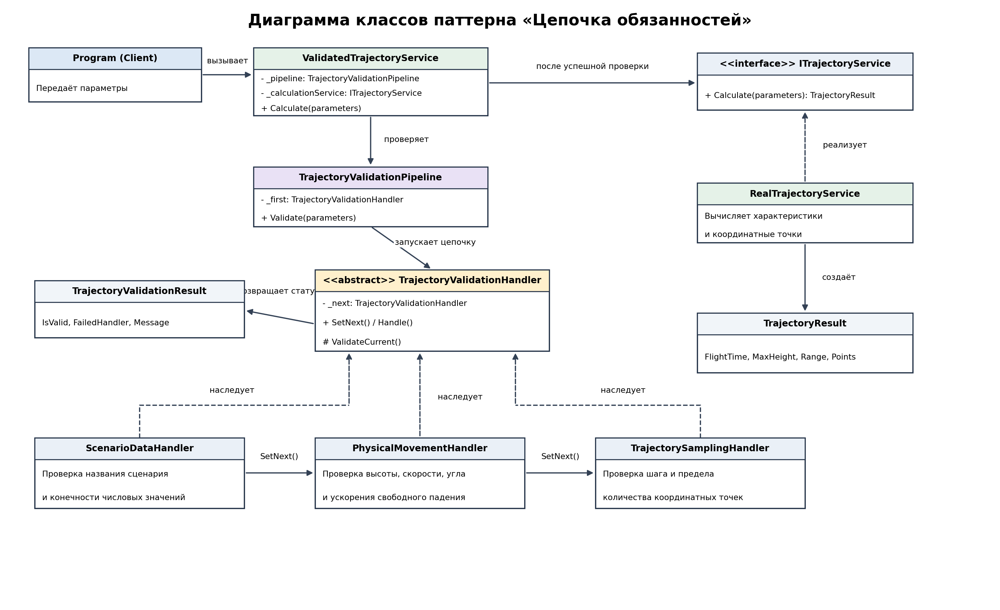
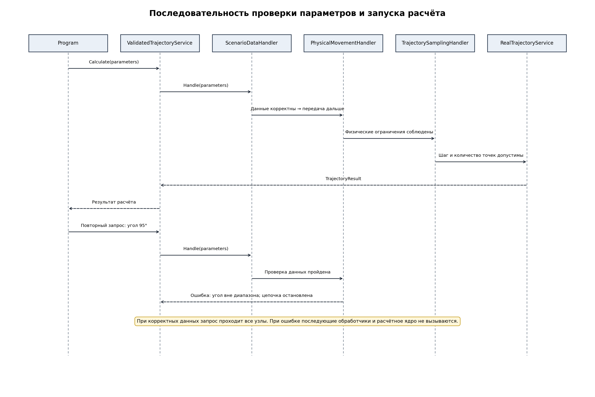
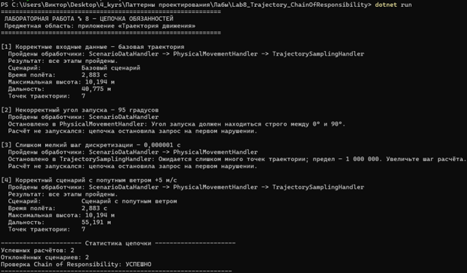

# Лабораторная работа 8. Поведенческий паттерн «Цепочка обязанностей»

**Министерство науки и высшего образования Российской Федерации**  
**Северо-Кавказский федеральный университет**  
Институт перспективной инженерии  
Департамент цифровых, робототехнических систем и электроники  

**Выполнил:** Блинов Виктор Александрович, 4 курс, группа ПИЖ-б-о-23-2, 09.03.04 «Программная инженерия», очная форма обучения  
**Проверил:** Белик А.И.  
Ставрополь, 2026 г.

---

Цель работы: изучить назначение поведенческого паттерна «Цепочка обязанностей» и применить его для последовательной проверки входных параметров модели движения до запуска вычислительной подсистемы.

Задание: разработать приложение предметной области согласно варианту 3 – «Траектория движения» – с использованием паттерна «Цепочка обязанностей».

Приложение моделирует движение тела, брошенного под углом к горизонту. Для корректных исходных параметров вычисляются время полёта, максимальная высота, дальность и координаты в различные моменты времени. Перед расчётом входные данные проходят последовательность специализированных проверок.

Паттерн «Цепочка обязанностей» позволяет разделить валидацию на несколько независимых обработчиков. Каждый обработчик проверяет свою группу условий и при успехе передаёт запрос следующему элементу. При обнаружении ошибки цепочка останавливается, а математический расчёт не запускается.

## 1. Архитектура решения

Приложение разделено на предметную модель, цепочку обработчиков проверки, сервис-координатор и математическое ядро. Модели TrajectoryParameters, TrajectoryPoint и TrajectoryResult соответствуют предметной области и сохраняют структуру, применённую в предыдущей лабораторной работе.

Интерфейс ITrajectoryService задаёт метод Calculate(). Класс ValidatedTrajectoryService реализует этот интерфейс и выступает обязательной точкой входа для клиентского кода. Перед обращением к расчётной подсистеме он запускает TrajectoryValidationPipeline.

Цепочка состоит из трёх конкретных обработчиков: ScenarioDataHandler, PhysicalMovementHandler и TrajectorySamplingHandler. Базовый класс TrajectoryValidationHandler содержит ссылку на следующий обработчик, метод SetNext() для построения цепочки и операцию Handle() для передачи запроса.

При успешной проверке всех этапов ValidatedTrajectoryService передаёт параметры объекту RealTrajectoryService. Этот класс выполняет математические вычисления и возвращает TrajectoryResult. При ошибке формируется TrajectoryValidationResult, содержащий имя обработчика, сообщение и список успешно пройденных этапов.

- Models – параметры сценария, координатная точка и результат;
- Core – интерфейс расчётного сервиса, сервис валидации и математическое ядро;
- Validation – базовый обработчик, конкретные обработчики, конвейер и результат проверки;
- Program.cs – запуск корректных и некорректных сценариев и демонстрация остановки цепочки.

## 2. Используемые технологии

- C# 12 и .NET 8;
- консольное приложение без сторонних библиотек;
- объектно-ориентированная архитектура;
- абстрактный класс и наследование для обработчиков;
- связанный список обработчиков через ссылку на следующий объект;
- исключение TrajectoryValidationException для передачи сведений об ошибке;
- UML-диаграммы классов и последовательности обработки запроса.

## 3. Паттерн «Цепочка обязанностей»

Паттерн «Цепочка обязанностей» (Chain of Responsibility) организует обработку запроса в виде последовательности связанных обработчиков. Клиент отправляет запрос первому обработчику, не выбирая конкретный объект, который должен принять решение. Каждый обработчик либо завершает обработку, либо передаёт запрос следующему элементу цепочки.

В данной работе базовый класс TrajectoryValidationHandler определяет ссылку _next, метод SetNext() и общий метод Handle(). Метод ValidateCurrent() переопределяется в конкретных обработчиках. Если проверка текущего обработчика успешна, он добавляет своё имя в список пройденных этапов и вызывает следующий обработчик. Если обнаружена ошибка, возвращается результат с именем обработчика и сообщением.

**Таблица 1 – Обработчики цепочки обязанностей**

| Обработчик | Проверяемые условия | Результат при ошибке |
| --- | --- | --- |
| ScenarioDataHandler | Параметры переданы; название сценария задано; все числовые значения конечны. | Остановка при отсутствии параметров, пустом названии или NaN/Infinity. |
| PhysicalMovementHandler | Начальная высота неотрицательна; скорость и g положительны; угол находится между 0° и 90°. | Остановка при нарушении физических ограничений. |
| TrajectorySamplingHandler | Шаг расчёта положителен; оценочное число точек не превышает 1 000 000. | Остановка при слишком мелком шаге или чрезмерном объёме точек. |

Порядок обработчиков фиксируется в TrajectoryValidationPipeline: сначала ScenarioDataHandler, затем PhysicalMovementHandler, после него TrajectorySamplingHandler. Такая последовательность позволяет сначала исключить некорректные значения, затем проверить физический смысл параметров и только после этого оценивать объём вычислений.

Класс ValidatedTrajectoryService использует цепочку перед каждым расчётом. Если валидация не пройдена, выбрасывается TrajectoryValidationException, которая содержит TrajectoryValidationResult. Объект RealTrajectoryService вызывается только при успешном результате проверки.



*Рисунок 1 – Диаграмма классов паттерна «Цепочка обязанностей»*

На диаграмме показаны сервис-координатор, конвейер валидации, базовый класс обработчика и три конкретных обработчика. Связи SetNext() формируют цепочку. Отдельно показан расчётный сервис, к которому можно обратиться только после успешной проверки.



*Рисунок 2 – Диаграмма последовательности проверки параметров*

Диаграмма демонстрирует два случая: корректный запрос последовательно проходит три обработчика и передаётся математическому ядру; запрос с углом 95° останавливается на PhysicalMovementHandler, поэтому последующие этапы и расчёт не выполняются.

## 4. Математическая модель движения

Математическая модель совпадает с моделью предыдущей лабораторной работы. Сопротивление воздуха не учитывается, а скорость ветра считается постоянной и влияет только на горизонтальное движение.

> Составляющие начальной скорости:  vₓ = v₀ · cos(α);   vᵧ = v₀ · sin(α).

> Горизонтальная координата:  x(t) = x₀ + (vₓ + w) · t.

> Вертикальная координата:  y(t) = y₀ + vᵧ · t − g · t² / 2.

> Время полёта:  T = (vᵧ + √(vᵧ² + 2 · g · y₀)) / g.

> Максимальная высота:  Hmax = y₀ + vᵧ² / (2 · g).

> Дальность:  L = x₀ + (vₓ + w) · T.

где v₀ – начальная скорость; α – угол запуска; w – горизонтальная скорость ветра; g – ускорение свободного падения. Цепочка обязанностей не изменяет математические формулы, а гарантирует, что вычислительная подсистема получает параметры, прошедшие необходимые проверки.

## 5. Ключевые фрагменты исходного кода

**Листинг 1 – Связывание обработчиков**

```csharp
public TrajectoryValidationHandler SetNext(
    TrajectoryValidationHandler next)
{
    _next = next ?? throw new ArgumentNullException(nameof(next));
    return next;
}
```

Метод SetNext() устанавливает ссылку на следующий обработчик и возвращает его. Благодаря этому цепочка может собираться последовательным вызовом SetNext().

**Листинг 2 – Передача запроса по цепочке**

```csharp
private TrajectoryValidationResult HandleNext(
    TrajectoryParameters? parameters,
    List<string> passedHandlers)
{
    var error = ValidateCurrent(parameters);
    if (error is not null)
        return new(false, Name, error, passedHandlers.AsReadOnly());

    passedHandlers.Add(Name);
    return _next is null
        ? new(true, string.Empty, "Все проверки пройдены.",
              passedHandlers.AsReadOnly())
        : _next.HandleNext(parameters, passedHandlers);
}
```

Каждый обработчик выполняет собственную проверку. При ошибке метод сразу возвращает результат отказа; обращение к _next в этом случае не производится. При успехе имя обработчика добавляется в PassedHandlers, после чего запрос передаётся следующему звену.

**Листинг 3 – Формирование цепочки обработчиков**

```csharp
var data = new ScenarioDataHandler();
var physics = new PhysicalMovementHandler();
var sampling = new TrajectorySamplingHandler();

data.SetNext(physics).SetNext(sampling);
_first = data;
```

**Листинг 4 – Допуск к расчётной подсистеме**

```csharp
public TrajectoryResult Calculate(TrajectoryParameters parameters)
{
    var validation = _pipeline.Validate(parameters);
    if (!validation.IsValid)
        throw new TrajectoryValidationException(validation);

    var result = _calculationService.Calculate(parameters);
    SuccessfulCalculations++;
    return result;
}
```

## 6. Проверка корректности и ограничения

Проверка состоит из трёх независимых этапов. На первом этапе проверяется наличие объекта параметров, название сценария и конечность всех числовых значений. На втором этапе контролируются ограничения физической модели. На третьем этапе определяется предполагаемое количество точек траектории по времени полёта и шагу дискретизации.

Для демонстрации паттерна выполняются четыре контрольных сценария:

- Базовая траектория с корректными значениями проходит все три обработчика и рассчитывается.
- Сценарий с углом запуска 95° проходит ScenarioDataHandler, но отклоняется в PhysicalMovementHandler.
- Сценарий с шагом 0,000001 с проходит первые два обработчика, но отклоняется в TrajectorySamplingHandler, так как оценочное число точек превышает установленный предел.
- Сценарий с попутным ветром +5 м/с проходит все обработчики и рассчитывается.

Предельное значение для траектории составляет 1 000 000 точек. Для базового сценария время полёта составляет около 2,883 с. При шаге 0,000001 с ожидаемое количество точек превышает 2,8 млн, поэтому запрос блокируется до выделения памяти под координатную коллекцию.

В реализации возвращается первая обнаруженная ошибка. Цепочка не предназначена для одновременного накопления всех замечаний: для такого поведения потребовалось бы изменить контракт обработчика и передавать запрос дальше даже после неуспешной проверки.

## 7. Результат работы программы

Для корректных сценариев используются те же параметры, что и в лабораторной работе № 6: начальная точка (0; 0) м, скорость 20 м/с, угол 45°, ускорение свободного падения 9,81 м/с² и шаг 0,5 с. Для второго корректного сценария добавляется попутный ветер +5 м/с.



**Таблица 2 – Результаты обработки сценариев**

| Сценарий | Пройденные обработчики | Результат |
| --- | --- | --- |
| Базовый сценарий | ScenarioData → PhysicalMovement → TrajectorySampling | Расчёт выполнен: T = 2,883 с; Hmax = 10,194 м; L = 40,775 м. |
| Угол 95° | ScenarioData | Остановлено в PhysicalMovementHandler. |
| Шаг 0,000001 с | ScenarioData → PhysicalMovement | Остановлено в TrajectorySamplingHandler; более 1 000 000 точек. |
| Попутный ветер +5 м/с | ScenarioData → PhysicalMovement → TrajectorySampling | Расчёт выполнен; дальность 55,191 м. |

Математическое ядро вызывается только для двух корректных сценариев. Два других запроса отклоняются на соответствующих этапах проверки. Поэтому счётчик SuccessfulCalculations должен иметь значение 2, а программа выводит сообщение «Проверка Chain of Responsibility: УСПЕШНО».

## 8. Что подтверждает применение паттерна

- Запрос передаётся первому обработчику цепочки через TrajectoryValidationPipeline.
- Каждый обработчик отвечает за отдельную группу условий и не содержит проверки других этапов.
- Связь SetNext() позволяет менять состав и порядок обработчиков без изменения клиентского кода.
- При успешной проверке запрос передаётся следующему обработчику.
- При первой ошибке цепочка останавливается и возвращает имя обработчика и сообщение.
- RealTrajectoryService вызывается только после успешного прохождения всей цепочки.

Вывод: в ходе лабораторной работы разработано приложение «Траектория движения» с применением поведенческого паттерна «Цепочка обязанностей». Проверка параметров разделена на три последовательных этапа: проверку исходных данных, физических ограничений и параметров дискретизации.

Использование цепочки позволяет изолировать правила валидации, упростить добавление новых проверок и не допускать запуск вычислений для некорректных сценариев. Контрольные примеры показывают как успешную обработку параметров, так и прекращение цепочки на первом обнаруженном нарушении.
