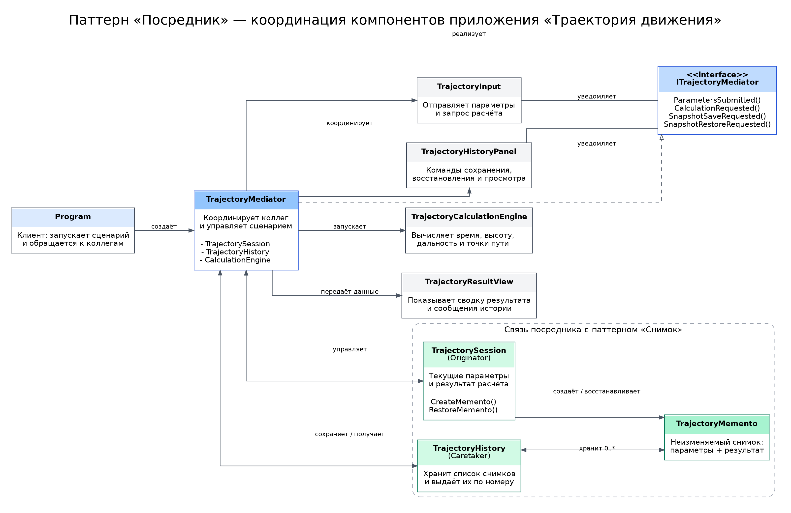
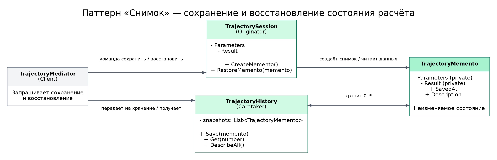
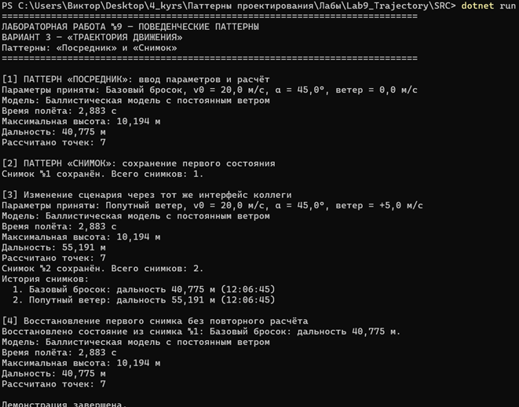

# Лабораторная работа №9

**Дисциплина:** Паттерны проектирования  
**Тема:** Поведенческие паттерны: «Посредник», «Снимок»  
**Выполнил:** Блинов Виктор Александрович, 4 курс, группа ПИЖ-б-о-23-2  
**Направление подготовки:** 09.03.04 «Программная инженерия», очная форма обучения  
**Проверил:** Белик А. И., ассистент департамента цифровых, робототехнических систем и электроники  
**Учебное заведение:** Северо-Кавказский федеральный университет, Институт перспективной инженерии  
**Место и год:** Ставрополь, 2026 г.

**Оценка за защиту:** ____________  
**Дата защиты:** ____________  
**Подписи:** студент ____________ · преподаватель ____________

---

**Цель работы:** изучить назначение поведенческих паттернов «Посредник» и «Снимок» и применить их при разработке прикладного программного решения.

**Задание:** реализовать приложение из предметной области согласно варианту 3 — «Траектория движения», используя паттерны из перечня лабораторной работы №9: «Посредник» и «Снимок».

В приложении рассчитывается траектория тела, брошенного под углом к горизонту. Входные параметры включают начальные координаты, скорость, угол запуска, ускорение свободного падения, шаг расчёта и скорость ветра. Паттерн «Посредник» координирует взаимодействие компонентов ввода, вычисления, отображения и управления историей. Паттерн «Снимок» сохраняет параметры и полученный результат, позволяя восстановить предыдущее состояние без повторного вычисления.

## 1. Архитектура решения

Программа разделена на предметные модели, расчётный модуль, посредника и подсистему снимков. `TrajectoryParameters` хранит исходные данные сценария, `TrajectoryPoint` представляет координаты тела в отдельный момент времени, а `TrajectoryResult` содержит время полёта, максимальную высоту, дальность и последовательность расчётных точек.

В паттерне «Посредник» интерфейс `ITrajectoryMediator` задаёт операции, через которые коллеги передают запросы. Конкретный посредник `TrajectoryMediator` принимает параметры от `TrajectoryInput`, запускает `TrajectoryCalculationEngine`, направляет данные в `TrajectoryResultView` и обрабатывает запросы `TrajectoryHistoryPanel`. Компоненты не обращаются друг к другу напрямую.

В паттерне «Снимок» класс `TrajectorySession` является источником состояния (Originator). Он создаёт `TrajectoryMemento`, включающий параметры текущего сценария и рассчитанный результат. `TrajectoryHistory` выполняет роль хранителя (Caretaker): сохраняет снимки, присваивает им номера и возвращает выбранный снимок посреднику. Внутренние данные снимка скрыты от хранителя.

Структура проекта:

- `SRC/Models` — параметры движения, точка траектории и результат;
- `SRC/Calculation` — вычислительный механизм;
- `SRC/Mediator` — интерфейс посредника, коллеги и конкретный посредник;
- `SRC/Memento` — источник состояния, снимок и хранитель истории;
- `SRC/Validation` — проверка входных параметров;
- `UML` — исходные DOT-файлы и изображения диаграмм;
- `SRC/Program.cs` — демонстрация совместной работы паттернов.

## 2. Используемые технологии

- C# 12 и .NET 8;
- консольное приложение без сторонних библиотек;
- неизменяемые record-модели для параметров и результата;
- UML-диаграммы классов для отображения структуры паттернов;
- разделение исходного кода по предметным областям и ролям паттернов.

## 3. Паттерн «Посредник»

Паттерн «Посредник» применяется для уменьшения прямых зависимостей между компонентами системы. Если каждый компонент будет обращаться к остальным напрямую, изменение одного элемента может потребовать изменений в нескольких классах. В разработанном приложении ввод параметров, история снимков и отображение результата взаимодействуют только через `ITrajectoryMediator`.

`TrajectoryInput` передаёт посреднику новые параметры и команду запуска расчёта. `TrajectoryHistoryPanel` сообщает о необходимости сохранить снимок, вывести историю или восстановить состояние. `TrajectoryMediator` проверяет параметры, обновляет `TrajectorySession`, запускает расчётный механизм, а затем передаёт результат представлению. Таким образом, коллеги не знают о внутреннем устройстве друг друга.

| Роль | Класс / интерфейс | Ответственность |
|---|---|---|
| Mediator | `ITrajectoryMediator` | Определяет операции обмена сообщениями между коллегами. |
| Concrete Mediator | `TrajectoryMediator` | Координирует ввод, вычисление, отображение и историю снимков. |
| Colleague | `TrajectoryInput` | Передаёт исходные параметры и запрос на расчёт. |
| Colleague | `TrajectoryHistoryPanel` | Передаёт команды сохранения, просмотра и восстановления снимков. |
| Colleague | `TrajectoryResultView` | Отображает результаты и сообщения, полученные от посредника. |
| Вычислительный компонент | `TrajectoryCalculationEngine` | Рассчитывает физические характеристики траектории. |

Таблица 1 – Участники паттерна «Посредник»



*Рисунок 1 – Диаграмма классов паттерна «Посредник»*

Диаграмма показывает, что коллеги используют единый интерфейс `ITrajectoryMediator`, а конкретный посредник управляет последовательностью действий. Расчётный компонент и представление не связаны друг с другом: посредник самостоятельно передаёт результат отображению.

Основной контракт паттерна:

```csharp
public interface ITrajectoryMediator
{
    void ParametersSubmitted(TrajectoryParameters parameters);
    void CalculationRequested();
    void SnapshotSaveRequested();
    void SnapshotRestoreRequested(int number);
    void SnapshotListRequested();
}
```

*Листинг 1 – Интерфейс взаимодействия коллег через посредника*

Ключевая часть конкретного посредника выполняет проверку введённых параметров, вызывает расчёт и обновляет модель сессии:

```csharp
public void CalculationRequested()
{
    if (_session.Parameters is null)
        throw new InvalidOperationException(
            "Сначала необходимо задать параметры движения.");

    TrajectoryResult result = _calculator.Calculate(_session.Parameters);
    _session.SetResult(result);
    _resultView.ShowResult(result);
}
```

*Листинг 2 – Координация расчёта классом `TrajectoryMediator`*

## 4. Паттерн «Снимок»

Паттерн «Снимок» позволяет сохранить внутреннее состояние объекта и позднее восстановить его. В предметной области приложения это необходимо, чтобы пользователь мог вернуться к ранее рассчитанному сценарию, например сравнить траекторию без ветра и траекторию при попутном ветре.

Класс `TrajectorySession` выступает Originator и содержит текущие параметры и результат. Метод `CreateMemento()` формирует неизменяемый объект `TrajectoryMemento`. В снимке сохраняются обе части состояния: исходные параметры запуска и результат с рассчитанными временными и координатными точками. Метод `RestoreMemento()` возвращает эти данные в сессию.

`TrajectoryHistory` является Caretaker. Он хранит список снимков, но не изменяет их внутреннее содержимое. Хранитель умеет добавить новый снимок, получить его по порядковому номеру и сформировать описание сохранённых сценариев. Внутренние поля `TrajectoryMemento` закрыты, а доступ к ним имеет только Originator в пределах сборки.

| Роль | Класс | Ответственность |
|---|---|---|
| Originator | `TrajectorySession` | Хранит актуальные параметры и результат, создаёт и восстанавливает снимок. |
| Memento | `TrajectoryMemento` | Неизменяемо хранит копию состояния сессии и время сохранения. |
| Caretaker | `TrajectoryHistory` | Сохраняет снимки и выдаёт их по номеру, не анализируя внутренние данные. |
| Client | `TrajectoryMediator` | Запрашивает сохранение или восстановление и координирует компоненты. |

Таблица 2 – Участники паттерна «Снимок»



*Рисунок 2 – Диаграмма классов паттерна «Снимок»*

Важное свойство решения — восстановление происходит без повторного запуска физической модели. Посредник получает объект снимка из истории и передаёт его источнику состояния. После восстановления в `TrajectorySession` находятся те же параметры и тот же результат, которые были сохранены ранее.

Ключевые методы Originator и Caretaker:

```csharp
public TrajectoryMemento CreateMemento()
{
    if (Parameters is null)
        throw new InvalidOperationException(
            "Нельзя сохранить снимок до ввода параметров.");

    return new TrajectoryMemento(Parameters, Result, DateTime.Now);
}

public void RestoreMemento(TrajectoryMemento memento)
{
    ArgumentNullException.ThrowIfNull(memento);
    Parameters = memento.Parameters;
    Result = memento.Result;
}
```

*Листинг 3 – Сохранение и восстановление состояния сессии*

```csharp
public int Save(TrajectoryMemento memento)
{
    ArgumentNullException.ThrowIfNull(memento);
    _snapshots.Add(memento);
    return _snapshots.Count;
}

public TrajectoryMemento Get(int number)
{
    if (number < 1 || number > _snapshots.Count)
        throw new ArgumentOutOfRangeException(nameof(number));

    return _snapshots[number - 1];
}
```

*Листинг 4 – Хранение снимков в классе `TrajectoryHistory`*

## 5. Математическая модель движения

Для сохранения единой предметной области используется та же баллистическая модель, что и в лабораторной работе №3. Начальная скорость раскладывается на горизонтальную и вертикальную составляющие. Угол запуска задаётся в градусах, а перед вычислением тригонометрических функций переводится в радианы.

\(v_x = v_0 \cdot \cos(\alpha)\)

\(v_y = v_0 \cdot \sin(\alpha)\)

\(x(t) = x_0 + (v_x + w) \cdot t\)

\(y(t) = y_0 + v_y \cdot t - g \cdot t^2 / 2\)

\(T = (v_y + \sqrt{v_y^2 + 2 \cdot g \cdot y_0}) / g\)

\(H_{max} = y_0 + v_y^2 / (2 \cdot g)\)

\(L = x_0 + (v_x + w) \cdot T\)

Здесь \(v_0\) — начальная скорость, \(\alpha\) — угол запуска, \(g\) — ускорение свободного падения, \(w\) — постоянная горизонтальная скорость ветра, \(T\) — время полёта, \(H_{max}\) — максимальная высота, \(L\) — дальность полёта. Ветер влияет на горизонтальное перемещение, но в принятой упрощённой модели не изменяет время полёта и максимальную высоту. Сопротивление воздуха и изменение ветра во времени не учитываются.

## 6. Ключевые фрагменты исходного кода

В клиентском коде создаётся один объект посредника. Ввод и управление историей выполняются через предоставленные им компоненты:

```csharp
var mediator = new TrajectoryMediator();
var parameters = new TrajectoryParameters(
    "Базовый бросок", 0.0, 0.0, 20.0, 45.0, 9.81, 0.5, 0.0);

mediator.Input.Submit(parameters);
mediator.Input.Calculate();
mediator.HistoryPanel.SaveSnapshot();

var windy = parameters with
{
    Name = "Попутный ветер",
    WindSpeed = 5.0
};
mediator.Input.Submit(windy);
mediator.Input.Calculate();
mediator.HistoryPanel.SaveSnapshot();
mediator.HistoryPanel.ShowHistory();
mediator.HistoryPanel.RestoreSnapshot(1);
```

*Листинг 5 – Сценарий расчёта, сохранения и восстановления снимка*

## 7. Проверка корректности и ограничения

Перед расчётом выполняется проверка входных параметров. Название сценария не должно быть пустым; координаты должны быть конечными числами; начальная высота не может быть отрицательной; скорость, ускорение свободного падения и шаг расчёта должны быть положительными; угол запуска должен находиться строго между 0° и 90°; скорость ветра должна быть конечным числом.

Для проверки паттерна «Посредник» последовательно выполняются ввод параметров, запуск расчёта, сохранение и отображение результата. Компоненты ввода и истории не вызывают друг друга напрямую, а используют методы посредника.

Для проверки паттерна «Снимок» сохраняются два состояния: базовый запуск без ветра и сценарий с попутным ветром. После изменения параметров выполняется восстановление снимка №1. Восстановленные параметры и значения результата соответствуют первому сценарию. Расчётная модель при восстановлении повторно не вызывается.

Решение предназначено для демонстрации паттернов в консольном приложении. `TrajectoryHistory` хранит снимки в оперативной памяти, поэтому история не сохраняется между отдельными запусками программы. Физическая модель соответствует учебным допущениям лабораторной работы №3.

## 8. Результат работы программы

Для проверки используются начальные координаты (0; 0) м, начальная скорость 20 м/с, угол запуска 45°, ускорение свободного падения 9,81 м/с² и шаг расчёта 0,5 с. Для второго сценария задаётся попутный ветер +5 м/с.

| Сценарий | Ветер, м/с | Время, с | Макс. высота, м | Дальность, м |
|---|---:|---:|---:|---:|
| Базовый бросок | 0 | 2,883 | 10,194 | 40,775 |
| Попутный ветер | +5 | 2,883 | 10,194 | 55,191 |
| Восстановленный снимок №1 | 0 | 2,883 | 10,194 | 40,775 |

Таблица 3 – Контрольные результаты расчёта и восстановления снимка



*Рисунок 3 – Контрольный пример вывода приложения для двух сценариев и восстановления снимка*

## 9. Что подтверждает применение паттернов

- `TrajectoryInput`, `TrajectoryHistoryPanel` и `TrajectoryResultView` не обмениваются данными напрямую; координацию выполняет `TrajectoryMediator`;
- посредник реализует интерфейс `ITrajectoryMediator`, через который коллеги передают запросы;
- `TrajectorySession` самостоятельно создаёт и восстанавливает снимки своего состояния;
- `TrajectoryMemento` хранит параметры и результат в неизменяемом объекте со скрытыми внутренними данными;
- `TrajectoryHistory` хранит снимки и предоставляет их по номеру, не изменяя содержимое;
- восстановление снимка №1 возвращает базовые параметры и результат без повторного расчёта траектории.

**Вывод:** В ходе лабораторной работы разработано приложение «Траектория движения» с применением поведенческих паттернов «Посредник» и «Снимок». Посредник централизует взаимодействие компонентов ввода, расчёта, отображения и истории, снижая связанность между ними. Снимок обеспечивает сохранение и восстановление параметров и результата траектории, что позволяет возвращаться к предыдущим сценариям без повторного вычисления.

---

## Запуск проекта

Требуется установленный .NET 8 SDK. Из каталога `SRC` выполните:

```bash
dotnet run
```
